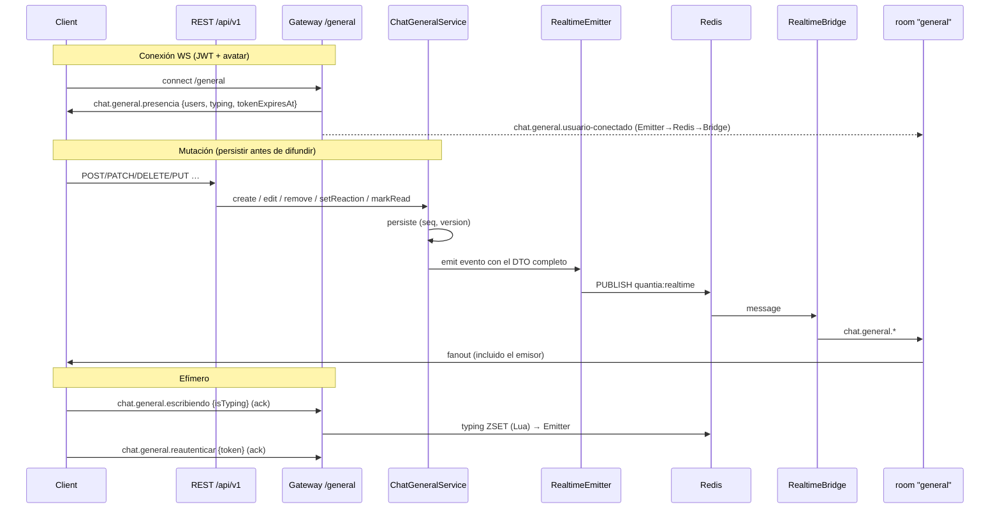

# Chat General del semillero (ENG-171 · v2)

Canal **General autenticado** para todo el semillero: no es un chat público anónimo ni un room de proyecto. Aditivo sobre el patrón F4 (`RealtimeEmitter` → Redis pub/sub → `RealtimeBridge` → `namespace.to(room).emit`).

**v2 (contracts 0.8.0)** añade: avatar obligatorio de 5 predefinidos, respuestas, edición, borrado (con moderación Admin), reacciones, typing, punteros de lectura, feed de cambios para reconexión, `seq`/`version` por mensaje, reautenticación del socket y endurecimiento de límites. El chat queda **activo por defecto** (`CHAT_GENERAL_ENABLED=true` salvo que se apague).

Registro de usuarios sigue siendo **solo Admin** (`POST /users`).

Docs relacionados:

- **Guía de integración para clientes:** [`../development/chat-e2e-integration.md`](../development/chat-e2e-integration.md)
- Cierre de fase v1 / AC: [`chat-general-closure.md`](./chat-general-closure.md) (ENG-173)
- Matriz de pruebas: [`chat-general-testing.md`](./chat-general-testing.md) (ENG-172 + v2)

## Decisiones de arquitectura

### Namespace `/general` + room fija `general`

| Opción                                 | Pros                                                                                              | Contras                                                                                              |
| -------------------------------------- | ------------------------------------------------------------------------------------------------- | ---------------------------------------------------------------------------------------------------- |
| **Namespace** `/general` **(elegida)** | Aislamiento total; auto-join sin tocar `join` de proyectos; feature flag limpio; presencia propia | Un socket más por pestaña (cuenta en `WS_MAX_CONNECTIONS_PER_USER`)                                  |
| Room `general` dentro de `/projects`   | Menos namespaces                                                                                  | Obliga a casos especiales en el gateway de proyectos; mezcla presencia de chat con fanout de dominio |

### Escrituras por REST, eventos por socket

Enviar, editar, borrar, reaccionar y marcar leído son endpoints REST: un solo camino de escritura con validación, throttling, auditoría HTTP y códigos de error estables. El socket solo **empuja** eventos y recibe dos mensajes efímeros (typing y reautenticación) con ack. Así un cliente puede operar aunque el socket esté reconectando, y los tests de contrato cubren todas las mutaciones.

### Orden y merge: `seq` + `version`

| Campo             | Origen                                                    | ¿Para qué?                                                                                                           |
| ----------------- | --------------------------------------------------------- | -------------------------------------------------------------------------------------------------------------------- |
| `seq`             | `BIGSERIAL` (backfill cronológico en la migración)        | Orden canónico; cursor de historial; puntero de lectura                                                              |
| `version`         | `INT`, +1 en cada edición, borrado o cambio de reacciones | Los clientes aplican un evento solo si su `version` es mayor: los eventos fuera de orden o repetidos son inofensivos |
| `clientMessageId` | Cliente (único por autor)                                 | Idempotencia + swap in-place de la burbuja optimista                                                                 |

Se eligió `seq` del servidor en vez de ordenar por `createdAt` porque es único, monótono y compacto para cursores y "leído hasta".

### Avatar obligatorio (sin fotos)

`users.avatar` (`AvatarKey`: `AVATAR_01`…`AVATAR_05`, nullable). Los recursos gráficos los empaqueta el front; la API solo guarda la clave. Mientras sea `null`, **todas** las rutas del chat responden `403 AVATAR_REQUIRED` y el socket se rechaza con el mismo código. No se bloquea el resto de la API (proyectos, tareas, …) para no romper flujos existentes. No hay endpoint de subida: elimina por diseño la superficie de ataque de archivos de imagen.

### Borrado

Soft delete: se vacía `content`, se eliminan las reacciones, se guardan `deletedAt` y `deletedById`, sube `version`. La fila queda como **tombstone** para que el feed de cambios propague el borrado a clientes desconectados. El historial no la devuelve; las respuestas que la citan muestran `replyTo.deleted=true`.

### Presencia y typing en Redis (no memoria local)

Claves (prefijo `quantia:chat:general:presence:`):

| Clave                   | Tipo   | Uso                                                     |
| ----------------------- | ------ | ------------------------------------------------------- |
| `users`                 | ZSET   | member=`userId`, score=`lastSeenEpochMs`                |
| `user:{userId}:sockets` | SET    | sockets activos del usuario                             |
| `socket:{socketId}`     | STRING | valor=`userId`, TTL `CHAT_GENERAL_PRESENCE_TTL_SECONDS` |
| `typing`                | ZSET   | member=`userId`, score=`expiresAtMs` (v2)               |
| `reconcile:lock`        | STRING | `SET NX PX` — una réplica limpia huérfanos              |

Join/leave atómicos vía Lua. `usuario-conectado` solo en transición 0→1 sockets; `usuario-desconectado` (con `lastSeenAt`) solo al cerrar el último, y además limpia el typing del usuario. Typing vía Lua: se difunde al **empezar** y luego como mucho cada `TTL/3` aunque el cliente refresque más seguido; la reconciliación purga entradas vencidas. La instantánea de `presencia` incluye quién está escribiendo, para que quien entra tarde vea el indicador.

### Límite de sockets por usuario (v2)

`ws:conn:v2:{userId}` es un ZSET (member=`socketId`, score=último heartbeat). Adquirir es un script Lua atómico (purga entradas sin heartbeat > 90 s → cuenta → registra). Cada réplica refresca sus sockets cada 30 s y, con `app.enableShutdownHooks()`, los libera al recibir `SIGTERM`. Esto corrige el bloqueo `Too many connections` que dejaban los sockets de réplicas reiniciadas con el `SET` de v1 (TTL 24 h renovado en cada conexión). Default `WS_MAX_CONNECTIONS_PER_USER=10`.

### Sesión del socket = vida del JWT

El JWT se valida en el handshake y se programa el cierre del socket en `exp + CHAT_GENERAL_TOKEN_GRACE_SECONDS` (`error TOKEN_EXPIRED`). El cliente, tras refrescar el token, envía `chat.general.reautenticar { token }`: se verifica (mismo usuario, activo) y se reprograma el cierre, sin reconectar ni hacer parpadear la presencia. Un usuario desactivado deja de recibir mensajes a más tardar cuando vence su token.

## Flujo de datos



## Persistencia (Prisma)

Migraciones: [`20260925200000_chat_general_messages`](../../prisma/migrations/20260925200000_chat_general_messages/migration.sql) (v1) · [`20261105000000_chat_general_v2_avatars`](../../prisma/migrations/20261105000000_chat_general_v2_avatars/migration.sql) (v2, aditiva). RLS deny-by-default en todas las tablas nuevas (F7).

```prisma
enum AvatarKey { AVATAR_01 AVATAR_02 AVATAR_03 AVATAR_04 AVATAR_05 }

model User {
  // …
  avatar AvatarKey?   // null hasta que el usuario elige
}

model GeneralChatMessage {
  id              String    @id @default(uuid()) @db.Uuid
  seq             BigInt    @unique @default(autoincrement())
  version         Int       @default(1)
  authorId        String    @db.Uuid
  content         String    @db.Text
  clientMessageId String?   @db.VarChar(64)
  replyToId       String?   @db.Uuid          // FK self, ON DELETE SET NULL
  createdAt       DateTime  @default(now())
  updatedAt       DateTime  @updatedAt
  editedAt        DateTime?
  deletedAt       DateTime?
  deletedById     String?   @db.Uuid

  @@unique([authorId, clientMessageId])
  @@index([createdAt, id])
  @@index([authorId, createdAt])
  @@index([updatedAt, id])                   // feed de cambios
}

model GeneralChatReaction {                   // una por usuario y mensaje
  messageId String @db.Uuid
  userId    String @db.Uuid
  emoji     String @db.VarChar(16)
  createdAt DateTime @default(now())
  @@id([messageId, userId])
}

model GeneralChatReadState {                  // puntero monótono
  userId      String @id @db.Uuid
  lastReadSeq BigInt @default(0)
  updatedAt   DateTime @updatedAt
}
```

`seq` se añade como `BIGINT` + secuencia propia y se rellena con `ROW_NUMBER() OVER (ORDER BY created_at, id)` para que el historial existente conserve su orden (un `BIGSERIAL` directo numeraría por orden físico). El puntero de lectura usa `INSERT … ON CONFLICT DO UPDATE … WHERE last_read_seq < EXCLUDED.last_read_seq` (solo avanza, atómico).

Un mensaje se carga con autor, cita (y su autor) y reacciones en **una** consulta (`messageInclude`), sin N+1.

### Normalización de contenido

`sanitizeChatContent`: Unicode NFC, `CRLF → LF`, elimina caracteres de control C0/C1 (salvo `\n`/`\t`) y overrides bidi (U+202A–U+202E, U+2066–U+2069, usados para spoofing), máximo 2 líneas en blanco seguidas, trim. El contenido es texto plano; no se interpreta HTML/Markdown en el servidor y los clientes deben pintarlo como texto.

### Cursores

`.cursorrules` pide `page`/`pageSize`; el chat usa **cursor** a propósito (feed append-only). Historial: `base64url("s:<seq>")`, orden `seq desc`. Feed de cambios: `base64url("u:<updatedAt>|<id>")`, orden `updatedAt asc, id asc`. Ambos son opacos para el cliente.

## Contratos

Definidos en [`packages/contracts/src/chat-general.ts`](../../packages/contracts/src/chat-general.ts) y [`avatars.ts`](../../packages/contracts/src/avatars.ts). Payloads completos y reglas de cliente: [guía de integración §6–§7](../development/chat-e2e-integration.md).

| Evento (servidor → cliente) | Payload |
| --------------------------- | ------- |
| `chat.general.presencia` | `{ users, typing, generatedAt, tokenExpiresAt }` (solo al socket que entra) |
| `chat.general.usuario-conectado` | `{ user, occurredAt }` |
| `chat.general.usuario-desconectado` | `{ userId, occurredAt, lastSeenAt }` |
| `chat.general.usuario-actualizado` | `{ user, occurredAt }` (cambio de avatar) |
| `chat.general.mensaje-creado` | `{ message }` |
| `chat.general.mensaje-editado` | `{ message }` |
| `chat.general.mensaje-eliminado` | `{ id, seq, version, deletedAt, byModerator }` |
| `chat.general.reacciones-actualizadas` | `{ messageId, seq, version, reactions, actorId, emoji }` |
| `chat.general.escribiendo` | `{ user, isTyping, expiresInMs }` |
| `chat.general.lectura` | `{ userId, lastReadSeq, readAt }` |
| `error` | `{ code, message }` |

| Evento (cliente → servidor, con ack) | Payload |
| ------------------------------------ | ------- |
| `chat.general.escribiendo` | `{ isTyping }` |
| `chat.general.reautenticar` | `{ token }` |

`PresenceUser = { id, name, avatar, avatarUrl: null }` — nunca email, roles ni tokens. `ChatGeneralErrorCode`: `CHAT_DISABLED`, `AVATAR_REQUIRED`, `UNAUTHORIZED`, `TOKEN_EXPIRED`, `TOO_MANY_CONNECTIONS`, `RATE_LIMITED`, `INVALID_PAYLOAD`, `MESSAGE_NOT_FOUND`, `REPLY_TARGET_NOT_FOUND`, `NOT_MESSAGE_AUTHOR`, `EDIT_WINDOW_EXPIRED`. El `HttpExceptionFilter` añade `code` al cuerpo de error cuando la excepción lo trae (aditivo para el resto de la API).

Los eventos RF-12/RF-13 y los namespaces `/projects` / `/notifications` **no cambian**.

## REST (`/api/v1`)

| Método | Ruta | Notas |
| ------ | ---- | ----- |
| `GET` | `/users/avatars` | Catálogo de 5 avatares |
| `PATCH` | `/users/me/avatar` | `{ avatar }`; emite `usuario-actualizado` |
| `GET` | `/chat/general/state` | Bootstrap: `latestSeq`, `lastReadSeq`, `unreadCount`, `readStates`, `limits`, `reactions` |
| `GET` | `/chat/general/messages?cursor=&limit=` | Historial `seq desc`, sin borrados |
| `POST` | `/chat/general/messages` | `{ content, clientMessageId?, replyToId? }` → 201 / 200 replay (re-emite) |
| `PATCH` | `/chat/general/messages/:id` | Autor, dentro de `CHAT_GENERAL_EDIT_WINDOW_SECONDS` |
| `DELETE` | `/chat/general/messages/:id` | Autor o `ADMINISTRADOR`; 204 idempotente |
| `PUT` | `/chat/general/messages/:id/reaction` | `{ emoji }` del allowlist; reemplaza |
| `DELETE` | `/chat/general/messages/:id/reaction` | Quita la mía |
| `PUT` | `/chat/general/read` | `{ lastReadSeq }` monótono, acotado al último `seq` |
| `GET` | `/chat/general/updates?since=|cursor=&limit=` | Feed de cambios con tombstones + `serverTime` |

Todas requieren JWT + flag + avatar. Throttle `chat-general` (`CHAT_GENERAL_RATE_LIMIT`/min) cubre `POST`/`PATCH`/`DELETE` de mensajes; reacciones, lectura y lecturas usan el throttle `default`. OpenAPI con schemas de respuesta: [`openapi/openapi.json`](../../openapi/openapi.json).

## Variables de entorno

| Variable                             | Default   | Notas                                         |
| ------------------------------------ | --------- | --------------------------------------------- |
| `CHAT_GENERAL_ENABLED`               | `true`    | `false` = kill switch (REST 404 + WS reject)  |
| `CHAT_GENERAL_ROOM`                  | `general` | Room Socket.io                                |
| `CHAT_GENERAL_HISTORY_DEFAULT_LIMIT` | `30`      |                                               |
| `CHAT_GENERAL_HISTORY_MAX_LIMIT`     | `100`     | También tope del feed de cambios              |
| `CHAT_GENERAL_MESSAGE_MAX_LENGTH`    | `2000`    | Tope duro contrato 4000                       |
| `CHAT_GENERAL_PRESENCE_TTL_SECONDS`  | `60`      |                                               |
| `CHAT_GENERAL_HEARTBEAT_SECONDS`     | `20`      | Debe ser `<` TTL                              |
| `CHAT_GENERAL_RATE_LIMIT`            | `20`      | Envíos + ediciones + borrados por minuto      |
| `CHAT_GENERAL_EDIT_WINDOW_SECONDS`   | `172800`  | 48 h; `0` = sin límite                        |
| `CHAT_GENERAL_TYPING_TTL_MS`         | `6000`    | 1000–30000                                    |
| `CHAT_GENERAL_TOKEN_GRACE_SECONDS`   | `30`      | 0–300                                         |
| `WS_MAX_CONNECTIONS_PER_USER`        | `10`      | Antes 5                                       |

## Despliegue

### Local

```bash
docker compose up -d postgres redis
cp .env.example .env
npx prisma migrate deploy
npm run prisma:seed
npm run start:dev
```

### Railway (staging)

1. Merge a `main` → servicio `migrate` (`prisma migrate deploy`, aplica la v2) → restart API.
2. `.railway/railway.ts` usa `preserve()`: revisar en el servicio `Quantia_API` que `CHAT_GENERAL_ENABLED` no esté en `false` y subir `WS_MAX_CONNECTIONS_PER_USER` a `10` si sigue en `5`. Las variables nuevas tienen defaults seguros.
3. Si se escala a >1 réplica: clientes con `transports: ['websocket']`; presencia, typing, límites y fanout ya van por Redis.
4. Smoke: `GET /health`, login, `GET /users/me` (`avatarRequired`), `PATCH /users/me/avatar`, `POST`/`PATCH`/`DELETE` mensaje, dos clientes `wss://…/general` (presencia, typing, eventos).
5. Rollback rápido: `CHAT_GENERAL_ENABLED=false`. La migración es aditiva; código v1 sigue funcionando sobre el esquema v2 (columnas nuevas con default/nullable).

## Observabilidad, rollback y limitaciones

- Logs Nest/Pino: warnings `Presence tick failed`, `WS conn heartbeat failed`, rechazos de socket con motivo. Sin métricas Prometheus dedicadas.
- Rollback: flag a `false`; no hace falta revertir la migración.

| Límite | Detalle |
|--------|---------|
| Sin adjuntos, menciones, fijados, hilos, DMs, push | Fuera de alcance v2 |
| `reactions[].userIds` | Lista completa; adecuada al tamaño del semillero |
| Citas | El extracto se calcula al leer; los clientes actualizan citas en memoria al recibir `mensaje-editado` |
| Feed de cambios | Usar solape de ~5 s en `since` (orden de commit vs `updatedAt`) |
| Avatar en eventos de typing | Se toma del principal del socket; se actualiza al reautenticar |
| CORS en WebSocket | El upgrade WS no pasa por CORS; la protección es el JWT |

## Módulos de código

- [`src/chat-general/`](../../src/chat-general/) — REST, servicio, repositorio, errores con código, normalización
- [`src/users/`](../../src/users/) — avatar (`/users/avatars`, `/users/me/avatar`)
- [`src/realtime/general-realtime.gateway.ts`](../../src/realtime/general-realtime.gateway.ts) — handshake, typing, reautenticación, expiración
- [`src/realtime/chat-general-presence.service.ts`](../../src/realtime/chat-general-presence.service.ts) — presencia + typing
- [`src/realtime/ws-connection-limit.service.ts`](../../src/realtime/ws-connection-limit.service.ts) — límite de sockets v2
- [`src/realtime/ws-auth.service.ts`](../../src/realtime/ws-auth.service.ts) — verificación JWT reutilizable

Pruebas: [`chat-general-testing.md`](./chat-general-testing.md).
