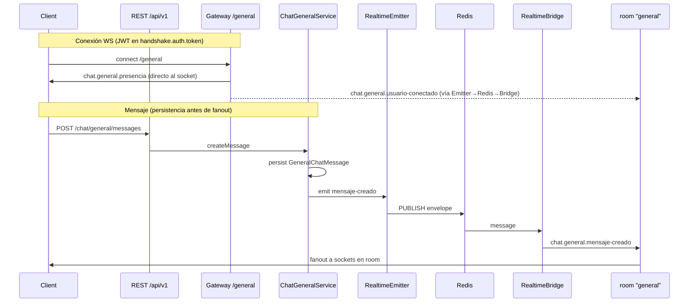

# Chat General del semillero (ENG-171)

Canal **General autenticado** para todo el semillero: no es un chat público anónimo ni un room de proyecto. Aditivo sobre el patrón F4 (`RealtimeEmitter` → Redis pub/sub → `RealtimeBridge` → `namespace.to(room).emit`).

Registro de usuarios sigue siendo **solo Admin** (`POST /users`); este documento no cambia auth.

Docs relacionados:

- Cierre de fase / AC: [`chat-general-closure.md`](./chat-general-closure.md) (ENG-173)
- Matriz de pruebas: [`chat-general-testing.md`](./chat-general-testing.md) (ENG-172)

## Decisiones de arquitectura

### Namespace `/general` + room fija `general`

| Opción                               | Pros                                                                                              | Contras                                                                                              |
| ------------------------------------ | ------------------------------------------------------------------------------------------------- | ---------------------------------------------------------------------------------------------------- |
| **Namespace `/general` (elegida)**   | Aislamiento total; auto-join sin tocar `join` de proyectos; feature flag limpio; presencia propia | Un socket más por pestaña (cuenta en `WS_MAX_CONNECTIONS_PER_USER`)                                  |
| Room `general` dentro de `/projects` | Menos namespaces                                                                                  | Obliga a casos especiales en el gateway de proyectos; mezcla presencia de chat con fanout de dominio |

`CHAT_GENERAL_ROOM` (default `general`) nombra la room Socket.io. JWT obligatorio (`handshake.auth.token`), igual que `/projects` y `/notifications`.

### Presencia en Redis (no memoria local)

Claves (prefijo `quantia:chat:general:presence:`):

| Clave                   | Tipo   | Uso                                                     |
| ----------------------- | ------ | ------------------------------------------------------- |
| `users`                 | ZSET   | member=`userId`, score=`lastSeenEpochMs`                |
| `user:{userId}:sockets` | SET    | sockets activos del usuario                             |
| `socket:{socketId}`     | STRING | valor=`userId`, TTL `CHAT_GENERAL_PRESENCE_TTL_SECONDS` |
| `reconcile:lock`        | STRING | `SET NX PX` — una réplica limpia huérfanos              |

Join/leave atómicos vía Lua. `usuario-conectado` solo en transición 0→1 sockets; `usuario-desconectado` solo al cerrar el último. Heartbeat por instancia renueva TTL; reconciliación elimina sockets cuya clave `socket:*` expiró (crash de réplica).

Instantánea al conectar: `client.emit('chat.general.presencia', …)` **directo** al socket (no pasa por el bridge).

## Flujo de datos



Presencia multi-réplica y fanout de mensajes usan el mismo Redis; no hay estado de presencia en memoria del proceso.

## Persistencia (Prisma)

Tabla Prisma `GeneralChatMessage` → `general_chat_messages` (migración [`prisma/migrations/20260925200000_chat_general_messages`](../../prisma/migrations/20260925200000_chat_general_messages/migration.sql)). Soft-delete `deletedAt`. Unique `(authorId, clientMessageId)` para idempotencia. RLS deny-by-default alineado a F7.

```prisma
model GeneralChatMessage {
  id              String    @id @default(uuid()) @db.Uuid
  authorId        String    @map("author_id") @db.Uuid
  content         String    @db.Text
  clientMessageId String?   @map("client_message_id") @db.VarChar(64)
  createdAt       DateTime  @default(now()) @map("created_at")
  updatedAt       DateTime  @updatedAt @map("updated_at")
  deletedAt       DateTime? @map("deleted_at")

  author User @relation(fields: [authorId], references: [id], onDelete: Restrict)

  @@unique([authorId, clientMessageId])
  @@index([createdAt, id])
  @@index([authorId, createdAt])
  @@map("general_chat_messages")
}
```

Índices: `(createdAt, id)` para historial cursor; `(authorId, createdAt)` para consultas por autor.

`avatarUrl` en contratos es siempre `null` hoy: `User` no tiene avatar y no se altera la tabla `users`.

### Cursor vs page/pageSize

`.cursorrules` pide `page`/`pageSize` en listados. El historial de chat usa **cursor** (`createdAt|id` en base64url) + `limit` con tope duro porque el feed es append-only y el offset se desplaza con mensajes nuevos (ENG-171). Documentado como desviación consciente.

## Eventos de contrato

Definidos en [`packages/contracts/src/chat-general.ts`](../../packages/contracts/src/chat-general.ts):

| Evento                              | Payload                                  |
| ----------------------------------- | ---------------------------------------- |
| `chat.general.presencia`            | `{ users: PresenceUser[], generatedAt }` |
| `chat.general.usuario-conectado`    | `{ user: PresenceUser, occurredAt }`     |
| `chat.general.usuario-desconectado` | `{ userId, occurredAt }`                 |
| `chat.general.mensaje-creado`       | `{ message: GeneralChatMessageDto }`     |

`PresenceUser`: `{ id, name, avatarUrl }` — nunca email, roles ni tokens.

Namespace añadido: `RealtimeNamespace.GENERAL = '/general'`. Envelope Redis acepta eventos de dominio **o** de chat.

Los eventos RF-12/RF-13 (`tarea.actualizada`, …) y los namespaces `/projects` / `/notifications` **no cambian**.

## REST (`/api/v1`)

Auth: JWT. Cualquier rol autenticado. Si `CHAT_GENERAL_ENABLED=false` → **404**.

| Method | Path                                    | Notas                                                                                                                                                                                  |
| ------ | --------------------------------------- | -------------------------------------------------------------------------------------------------------------------------------------------------------------------------------------- |
| `POST` | `/chat/general/messages`                | Body `{ content, clientMessageId? }`. **201** create / **200** idempotente. Throttle nombrado `chat-general` (`CHAT_GENERAL_RATE_LIMIT`/min). Persiste y luego emite `mensaje-creado`. |
| `GET`  | `/chat/general/messages?cursor=&limit=` | `{ items, nextCursor, hasMore }`. Default/max limit por env. Cursor inválido → 400.                                                                                                    |

No hay rol prohibido para estas rutas: **403 no aplica** (cualquier usuario activo del semillero). 401 sin token.

### Ejemplo `POST /api/v1/chat/general/messages`

Request:

```json
{
  "content": "Hola semillero",
  "clientMessageId": "client-msg-001"
}
```

Response **201** (primera vez) / **200** (idempotente con el mismo `clientMessageId`):

```json
{
  "id": "a1b2c3d4-e5f6-7890-abcd-ef1234567890",
  "content": "Hola semillero",
  "clientMessageId": "client-msg-001",
  "createdAt": "2026-09-25T20:00:00.000Z",
  "author": {
    "id": "11111111-2222-3333-4444-555555555555",
    "name": "Ana Investigadora",
    "avatarUrl": null
  }
}
```

Tras persistir, el servidor emite `chat.general.mensaje-creado` a la room `general` con `{ message: <mismo DTO> }`.

### Ejemplo `GET /api/v1/chat/general/messages?limit=2`

Response:

```json
{
  "items": [
    {
      "id": "a1b2c3d4-e5f6-7890-abcd-ef1234567890",
      "content": "Hola semillero",
      "clientMessageId": "client-msg-001",
      "createdAt": "2026-09-25T20:00:00.000Z",
      "author": {
        "id": "11111111-2222-3333-4444-555555555555",
        "name": "Ana Investigadora",
        "avatarUrl": null
      }
    }
  ],
  "nextCursor": "MjAyNi0wOS0yNVQyMDowMDowMC4wMDBafGExYjJjM2Q0LWU1ZjYtNzg5MC1hYmNkLWVmMTIzNDU2Nzg5MA",
  "hasMore": true
}
```

Página siguiente: `GET …/messages?cursor=<nextCursor>&limit=2`.

## Variables de entorno

| Variable                             | Default   | Notas                    |
| ------------------------------------ | --------- | ------------------------ |
| `CHAT_GENERAL_ENABLED`               | `false`   | Staging/local: `true`    |
| `CHAT_GENERAL_ROOM`                  | `general` | Nombre de room Socket.io |
| `CHAT_GENERAL_HISTORY_DEFAULT_LIMIT` | `30`      |                          |
| `CHAT_GENERAL_HISTORY_MAX_LIMIT`     | `100`     |                          |
| `CHAT_GENERAL_MESSAGE_MAX_LENGTH`    | `2000`    | Tope duro contrato 4000  |
| `CHAT_GENERAL_PRESENCE_TTL_SECONDS`  | `60`      |                          |
| `CHAT_GENERAL_HEARTBEAT_SECONDS`     | `20`      | Debe ser `<` TTL         |
| `CHAT_GENERAL_RATE_LIMIT`            | `20`      | POST/min                 |

`REDIS_URL`, `DATABASE_URL`, `DIRECT_URL` ya existían.

## Despliegue local (Docker)

```bash
docker compose up -d postgres redis
cp .env.example .env   # CHAT_GENERAL_ENABLED=true
npx prisma migrate deploy
npm run start:dev
```

Smoke local: `GET /api/v1/health`, `POST`/`GET` `/api/v1/chat/general/messages`, cliente Socket.io a `ws://localhost:<port>/general` con `auth.token` y `transports: ['websocket']`.

## Railway (staging)

### Prerrequisitos (ya cumplidos en Quantia_API)

- WebSocket/HTTP Upgrade en el mismo servicio que sirve `/projects` y `/notifications`.
- Redis managed (`redis` private endpoint + volumen `--save 60 1`) — **reutilizar**, no crear otro servicio.
- `replicas: { sfo: 1 }` hoy. Si se escala >1: clientes con `transports: ['websocket']` (sin sticky sessions el long-polling falla). Presencia y fanout ya van por Redis.
- Migraciones vía servicio `migrate` (`prisma migrate deploy` con `DIRECT_URL`).

### Antes del deploy

1. Añadir en Railway (servicio `Quantia_API` y legado `api` si aplica) al menos `CHAT_GENERAL_ENABLED=true`. El resto tiene defaults seguros.
2. Declaración IaC en [`.railway/railway.ts`](../../.railway/railway.ts) — aplicar con `railway config plan` → `apply` (manual).
3. Orden: merge a `main` → `migrate` → restart API.
4. Smoke: `GET /api/v1/health`, `POST`/`GET` chat, dos clientes `wss://…/general` (presencia + mensaje).
5. Rollback rápido: `CHAT_GENERAL_ENABLED=false` (REST 404 + WS reject).

Plantilla de evidencia smoke: [`evidence/chat-general-eng-172-staging.md`](./evidence/chat-general-eng-172-staging.md).

### Consideraciones

- Claves de presencia efímeras: reinicio de Redis → presencia se reconstruye con heartbeats.
- Subscriber del bridge: `retryStrategy` + resuscripción en `ready`.
- Una pestaña con `/projects` + `/notifications` + `/general` ocupa **3** de `WS_MAX_CONNECTIONS_PER_USER` (default 5). Subir a 8 es opcional.

## Observabilidad, rollback y limitaciones

### Observabilidad

- Gateway `/general` y `ChatGeneralPresenceService`: logs Nest (`Logger`) — warn en fallos de heartbeat/reconcile (`Presence tick failed`).
- `RealtimeEmitter` / `RealtimeBridge`: mismo canal Redis y logging estructurado (Pino + `requestId` en HTTP) que el resto de F4.
- No hay métricas Prometheus dedicadas al chat; fallos de presencia aparecen como warnings en logs de la API.

### Rollback

1. `CHAT_GENERAL_ENABLED=false` en Railway → REST responde **404**; gateway rechaza conexiones nuevas.
2. No hace falta borrar la tabla: mensajes históricos quedan; el flag corta el producto.
3. Migración es aditiva (`general_chat_messages`); no hay down automático en el runbook de staging.

### Limitaciones conocidas

| Límite | Detalle |
|--------|---------|
| `WS_MAX_CONNECTIONS_PER_USER` | Cada pestaña con `/general` cuenta 1 socket extra (además de `/projects` y `/notifications`). |
| `avatarUrl` | Siempre `null` hasta que exista avatar en `User`. |
| Paginación | Cursor (`createdAt\|id`) + `limit`, no `page`/`pageSize`. |
| Feature flag | Con `CHAT_GENERAL_ENABLED=false`, el namespace no está disponible (404 / reject). |
| Rate limit | `CHAT_GENERAL_RATE_LIMIT` POST/min por usuario (throttle Redis). |

## Módulos de código

- [`src/chat-general/`](../../src/chat-general/) — REST
- [`src/realtime/general-realtime.gateway.ts`](../../src/realtime/general-realtime.gateway.ts)
- [`src/realtime/chat-general-presence.service.ts`](../../src/realtime/chat-general-presence.service.ts)
- Emitter / bridge ampliados de forma aditiva

Pruebas: [`chat-general-testing.md`](./chat-general-testing.md) (ENG-172). Cierre de fase: [`chat-general-closure.md`](./chat-general-closure.md) (ENG-173).
