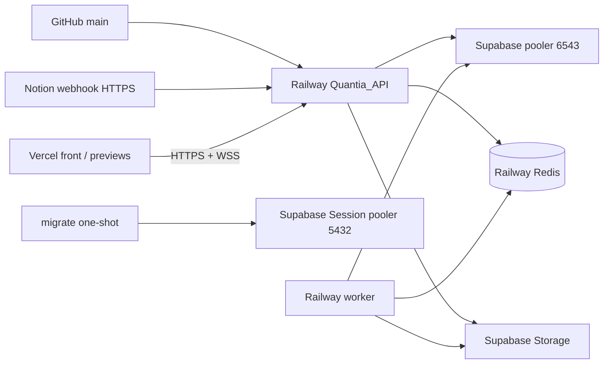

# F6 — Observabilidad y despliegue en Railway (ENG-125)

Staging vive en **Railway** (trial ahora; Hobby previsto en octubre).
Postgres y Storage siguen en **Supabase**. Redis es el plugin gestionado de Railway.

Production **no** se activa en el trial: queda documentada aquí y se crea como
proyecto aparte (`quantia-production`) con JWT/DB/Redis propios cuando pase a Hobby.

## Servicios (staging)

| Servicio | Origen | Comando | Dominio | Healthcheck |
|----------|--------|---------|---------|-------------|
| `Quantia_API` | **GitHub** `main` (primario) | `node dist/main.js` | `quantiaapi-production.up.railway.app` | `GET /api/v1/health` |
| `worker` | misma imagen / redeploy | `node dist/worker.js` | no | **desactivado** (sin HTTP) |
| `migrate` | Dockerfile `target: migrate` | `npx prisma migrate deploy` | no | one-shot |
| Redis | plugin Railway | — | interno | — |
| `api` | **legacy** (`railway up`) | — | `api-production-18cd…` | deprecar / no usar |

Deploy automático: merge a `main` → Railway construye `Quantia_API`. No hace falta `railway up` para la API.

Misma imagen runner para API y worker; start commands viven en [`.railway/railway.ts`](../../.railway/railway.ts) (IaC, ENG-158).

## Variables de entorno

Plantilla: [`.env.example`](../../.env.example). **Nunca** commits de secretos.

| Variable | Notas staging |
|----------|----------------|
| `NODE_ENV` | `production` |
| `PORT` | Lo inyecta Railway |
| `DATABASE_URL` | Transaction pooler `:6543` + `pgbouncer=true` |
| `DIRECT_URL` | **Staging policy (ENG-156):** Session pooler `:5432` on `*.pooler.supabase.com`. Direct `db.*:5432` solo si hay IPv6 real; no es requisito en trial. |
| `REDIS_URL` | Plugin Railway (`redis://` o `rediss://`) |
| `JWT_*` | Secretos **nuevos** (no reutilizar local). Incluye `JWT_ISSUER` / `JWT_AUDIENCE` (defaults `quantia-api` / `quantia-clients`) |
| `CORS_ORIGINS` | Dominio front cuando exista + localhost si hace falta |
| `CORS_VERCEL_PREVIEW` | `true` en staging |
| `NODE_OPTIONS` | `--max-old-space-size=350` (trial 0.5 GB) |
| `NOTION_*` / `SUPABASE_*` | `NOTION_WEBHOOK_SECRET` = `verification_token` del handshake |

Detalle smoke + URL pública: [`deploy-validation.md`](./deploy-validation.md).

Script local/CI de migrate: [`scripts/railway-migrate.sh`](../../scripts/railway-migrate.sh).

## Observabilidad

- Logs **JSON** en stdout vía `nestjs-pino` / `pino-http`.
- Cada request HTTP lleva `requestId` (header entrante `x-request-id` o UUID) y
  responde `X-Request-Id`.
- Redacción automática de `Authorization`, passwords, tokens y `verification_token`.
- Health checks de Terminus **no** se loguean en cada poll (ruido).
- `RAILWAY_GIT_COMMIT_SHA` aparece en props del log cuando Railway lo inyecta.
- `trust proxy` activo para IP real detrás del TLS de Railway.
- Retención de logs: corta en trial; **7 días** en Hobby.

## CORS y Socket.io

Allowlist CSV (`CORS_ORIGINS`, nunca `*`). Con `CORS_VERCEL_PREVIEW=true` se
aceptan solo orígenes `https://<subdominio>.vercel.app` (regex anclado).
La misma regla aplica a HTTP y a Socket.io ([`cors.util.ts`](../../src/common/cors.util.ts)).

## Notion — URL estable (sin túnel)

Staging actual:

`https://quantiaapi-production.up.railway.app/api/v1/webhooks/notion`

1. Crear/actualizar suscripción en Notion con esa URL.
2. Pegar el `verification_token` (logs de la API) en **Verify**.
3. Guardar ese **mismo** token como `NOTION_WEBHOOK_SECRET` (`Quantia_API` + `worker`) y redeploy.
   No hay un “Webhook secret” aparte; no usar el Access Token de la integración.
4. Eliminar suscripciones/túneles viejos (incluida cualquier URL `api-production-18cd…`).
5. Smoke: editar sandbox → `sync_events` `SYNCED`.

Detalle: [`notion.md`](./notion.md) · checklist: [`deploy-validation.md`](./deploy-validation.md).

## Rollback

Railway: healthcheck de la API falla → rollback al deploy anterior.
Imágenes ligadas al commit SHA del repo (`RAILWAY_GIT_COMMIT_SHA`).

## Trial vs Hobby

| | Trial (ahora) | Hobby (octubre) |
|--|---------------|-----------------|
| Crédito | $5 free | $5/mes + uso extra |
| RAM / servicio | 0.5 GB | hasta 8 GB / réplica |
| Entornos | **solo staging** | staging + production separados |
| Logs | corto | 7 días |
| Réplicas | 1 | hasta 5 |

En trial: evitar reportes Excel/PDF muy grandes (riesgo OOM). Production = **otro**
proyecto Railway + otro Redis + otro JWT + (idealmente) otro proyecto Supabase.

## RLS (F7)

Ver [`handoff-security.md`](./handoff-security.md). Migración `20260919000000_enable_rls`: RLS on + revoke PostgREST roles; Nest `DATABASE_URL` sigue con bypass (sin `FORCE`).

## Checklist de salida F6

- [x] Health 200 on Railway staging
- [x] Webhook Notion HTTPS sin túnel
- [x] 401 without JWT on protected route
- [ ] Origin CORS arbitrario rechazado; preview Vercel permitido si el flag está on
- [ ] Smoke WSS con JWT (manual)
- [ ] Front Vercel consume API (cuando exista el front)
