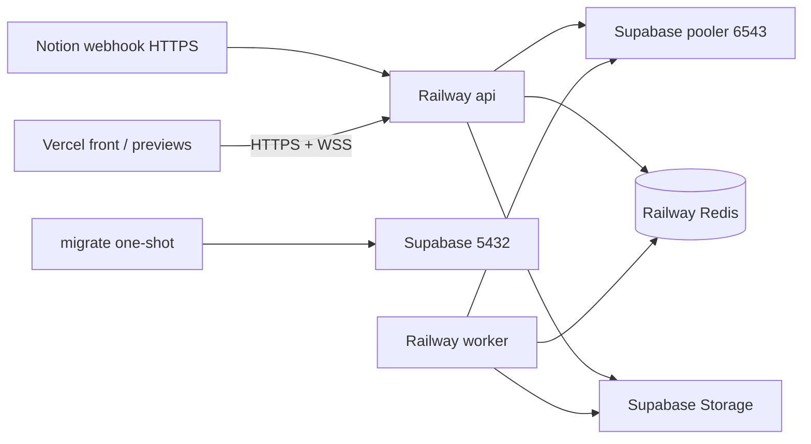

# F6 — Observabilidad y despliegue en Railway (ENG-125)

Staging vive en **Railway** (trial ahora; Hobby previsto en octubre).
Postgres y Storage siguen en **Supabase**. Redis es el plugin gestionado de Railway.

Production **no** se activa en el trial: queda documentada aquí y se crea como
proyecto aparte (`quantia-production`) con JWT/DB/Redis propios cuando pase a Hobby.

## Servicios (staging)

| Servicio | Imagen | Comando | Dominio | Healthcheck |
|----------|--------|---------|---------|-------------|
| `migrate` | Dockerfile `target: migrate` | `npx prisma migrate deploy` | no | one-shot |
| `api` | Dockerfile `runner` | `node dist/main.js` | HTTPS público | `GET /api/v1/health` |
| `worker` | misma `runner` | `node dist/worker.js` | no | **desactivado** (sin HTTP) |
| Redis | plugin Railway | — | interno | — |

Misma imagen para api y worker; solo cambia el start command ([`railway.toml`](../../railway.toml)).

## Variables de entorno

Plantilla: [`.env.example`](../../.env.example). **Nunca** commits de secretos.

| Variable | Notas staging |
|----------|----------------|
| `NODE_ENV` | `production` |
| `PORT` | Lo inyecta Railway |
| Direct (`db.<ref>.supabase.co:5432`) | Preferido si hay IPv6 | `DIRECT_URL` |
| **Session pooler** (`*.pooler.supabase.com:5432`) | **Usar si Direct es inalcanzable (solo AAAA / sin IPv6)** | `DIRECT_URL` (workaround staging) |
| Transaction pooler (`*.pooler.supabase.com:6543` + `pgbouncer=true`) | App + worker | `DATABASE_URL` |

Detalle del smoke staging y URL pública: [`deploy-validation.md`](./deploy-validation.md).

| `REDIS_URL` | Plugin Railway (`redis://` o `rediss://`) |
| `JWT_*` | Secretos **nuevos** (no reutilizar local) |
| `CORS_ORIGINS` | Dominio front cuando exista + localhost si hace falta |
| `CORS_VERCEL_PREVIEW` | `true` en staging |
| `NODE_OPTIONS` | `--max-old-space-size=350` (trial 0.5 GB) |
| `NOTION_*` / `SUPABASE_*` | Igual F3/F5; `NOTION_WEBHOOK_SECRET` = `verification_token` del handshake |

Script local/CI de migrate: [`scripts/railway-migrate.sh`](../../scripts/railway-migrate.sh).

## Observabilidad

- Logs **JSON** en stdout vía `nestjs-pino` / `pino-http`.
- Cada request HTTP lleva `requestId` (header entrante `x-request-id` o UUID) y
  responde `X-Request-Id`.
- Redacción automática de `Authorization`, passwords, tokens y `verification_token`.
- Health checks de Terminus **no** se loguean en cada poll (ruido).
- `RAILWAY_GIT_COMMIT_SHA` aparece en props del log cuando Railway lo inyecta.
- `trust proxy` activo para IP real detrás del TLS de Railway.
- Retención de logs: corta en trial; **7 días** en Hobby.

## CORS y Socket.io

Allowlist CSV (`CORS_ORIGINS`, nunca `*`). Con `CORS_VERCEL_PREVIEW=true` se
aceptan solo orígenes `https://<subdominio>.vercel.app` (regex anclado).
La misma regla aplica a HTTP y a Socket.io ([`cors.util.ts`](../../src/common/cors.util.ts)).

## Notion — URL estable (sin túnel)

Tras el primer deploy de la API:

1. Health OK: `https://<api>.up.railway.app/api/v1/health`
2. En Notion → Webhooks → URL  
   `https://<api>.up.railway.app/api/v1/webhooks/notion`
3. Completar `verification_token` → copiar signing secret → `NOTION_WEBHOOK_SECRET`
4. Redeploy api + worker
5. **Quitar** cualquier URL de cloudflared/ngrok
6. Smoke: editar en sandbox → fila `sync_events` `SYNCED`

Detalle del handshake: [`notion.md`](./notion.md).

## Rollback

Railway: healthcheck de la API falla → rollback al deploy anterior.
Imágenes ligadas al commit SHA del repo (`RAILWAY_GIT_COMMIT_SHA`).

## Trial vs Hobby

| | Trial (ahora) | Hobby (octubre) |
|--|---------------|-----------------|
| Crédito | $5 free | $5/mes + uso extra |
| RAM / servicio | 0.5 GB | hasta 8 GB / réplica |
| Entornos | **solo staging** | staging + production separados |
| Logs | corto | 7 días |
| Réplicas | 1 | hasta 5 |

En trial: evitar reportes Excel/PDF muy grandes (riesgo OOM). Production = **otro**
proyecto Railway + otro Redis + otro JWT + (idealmente) otro proyecto Supabase.

## Checklist de salida F6

- [x] Health 200 on Railway staging
- [x] Webhook Notion HTTPS sin túnel
- [ ] 401 without JWT on protected route
- [ ] Origin CORS arbitrario rechazado; preview Vercel permitido si el flag está on
- [ ] Smoke WSS con JWT (manual)
- [ ] Front Vercel consume API (cuando exista el front)
