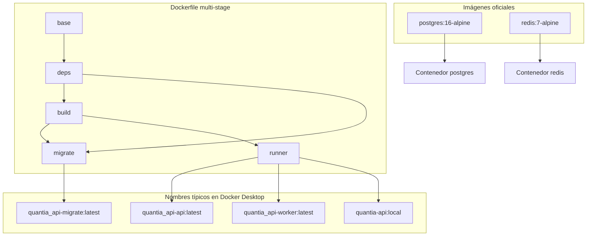
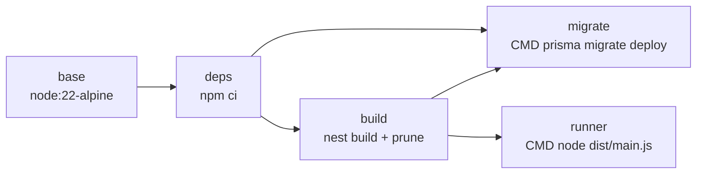
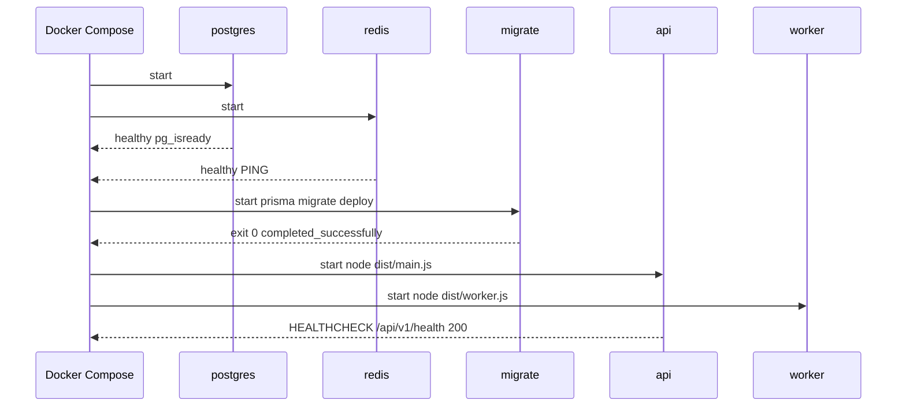
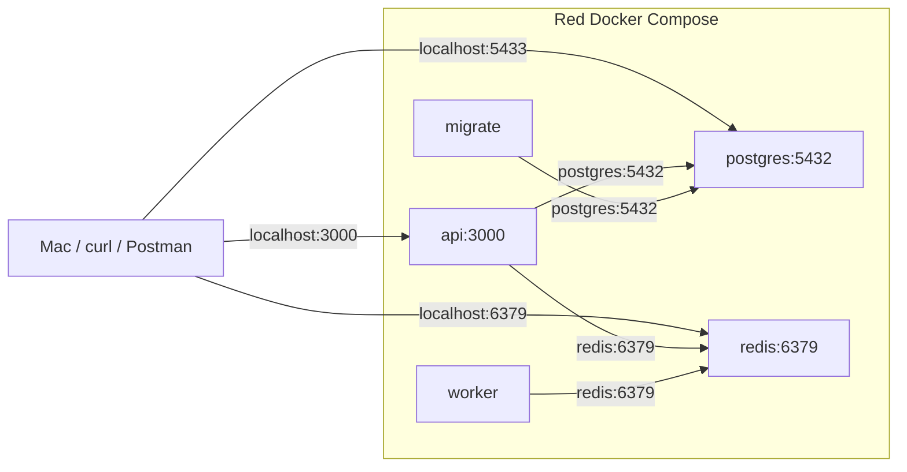

# Quantia API — Contenerización con Docker

Este documento explica **qué ves en Docker Desktop**, qué hace cada **imagen** y cada
**contenedor**, cómo se construyen a partir del `Dockerfile`, y en qué orden Compose
los arranca. Complementa `[overview.md](./overview.md)` (arquitectura de código) y
`[../development/local-setup.md](../development/local-setup.md)` (cómo levantarlo).

---

## Idea central

Quantia API no es un solo contenedor. En local hay **cinco roles**:


| Rol          | Tipo                       | Persistente             | Función en Quantia                                       |
| ------------ | -------------------------- | ----------------------- | -------------------------------------------------------- |
| **postgres** | Infra (imagen oficial)     | Sí (volumen `pgdata`)   | Sistema de registro (datos de la API)                    |
| **redis**    | Infra (imagen oficial)     | No (efímero en F0)      | Bus de colas/caché; el worker y (F4) Socket.io lo usarán |
| **migrate**  | App (build propio)         | No — **efímero**        | Aplica migraciones Prisma **antes** de servir tráfico    |
| **api**      | App (build propio)         | Sí mientras desarrollas | HTTP NestJS: `/api/v1/`*                                 |
| **worker**   | App (misma imagen que api) | Sí mientras desarrollas | Proceso aparte: trabajo asíncrono (stub en F0)           |


La API y el worker **comparten la misma imagen** (`target: runner`) y cambian solo el
comando de arranque. Eso cumple la invariante de Quantia: nada lento en el hilo HTTP;
el worker es el proceso correcto para sync Notion, PDF, correo, etc. (F3–F5).

---


## Lo que está en Docker Desktop (Images)

Tras `docker compose up --build` (y builds sueltos) suele aparecer algo como:


| Nombre en Desktop     | Tag              | Origen                                               | ¿Para qué existe?                                     |
| --------------------- | ---------------- | ---------------------------------------------------- | ----------------------------------------------------- |
| `postgres`            | `16-alpine`      | Docker Hub                                           | Motor PostgreSQL 16 ligero                            |
| `redis`               | `7-alpine`       | Docker Hub                                           | Redis 7 ligero                                        |
| `quantia_api-api`     | `latest`         | Build Compose → stage `runner`                       | Imagen de runtime de la API                           |
| `quantia_api-worker`  | `latest`         | Build Compose → stage `runner` (mismo Dockerfile)    | Misma capa de runtime; Compose le pone otro `command` |
| `quantia_api-migrate` | `latest`         | Build Compose → stage `migrate`                      | Imagen con Prisma CLI + schema para migrar            |
| `quantia-api`         | `local` (u otro) | Build manual (`docker build -t quantia-api:local .`) | Misma familia `runner`; etiqueta de prueba/CI local   |


### ¿Por qué `api` y `worker` pesan ~igual y `migrate` suele pesar más?

- `runner`: solo `dist/`, `node_modules` de producción (`npm prune --omit=dev`),
`prisma/` para el cliente, usuario `node`. Pensada para **ejecutar** la app.
- `migrate`: parte del stage `deps` (todavía con **devDependencies**, incluido
el CLI de Prisma). Por eso en Desktop puede verse **más grande** (~1.1 GB vs ~630 MB):
necesita `npx prisma migrate deploy`, no solo el runtime de Node.

No son “tres aplicaciones distintas de Quantia”: son **targets de build** del mismo
repositorio con propósitos distintos.




---


## Imagen vs contenedor


| Concepto       | Analogía                                    | En Quantia                                     |
| -------------- | ------------------------------------------- | ---------------------------------------------- |
| **Imagen**     | Plantilla / snapshot inmutable              | `quantia_api-api:latest`, `postgres:16-alpine` |
| **Contenedor** | Proceso en ejecución a partir de una imagen | `quantia_api-api-1`, `quantia_api-postgres-1`  |


Compose crea **un contenedor por servicio**. El servicio `migrate` termina y el
contenedor queda en estado **Exited (0)**; eso es correcto (no debe quedarse vivo).

---


## Stages del Dockerfile

Archivo: `[Dockerfile](../../Dockerfile)`.




| Stage     | ¿Qué hace?                                                      | ¿Quién lo usa?                                                |
| --------- | --------------------------------------------------------------- | ------------------------------------------------------------- |
| `base`    | `WORKDIR /app` sobre Node 22 Alpine                             | Base común                                                    |
| `deps`    | Copia manifests + `prisma/`, ejecuta `npm ci`                   | `build` y `migrate`                                           |
| `build`   | Copia el código, `npm run build`, `npm prune --omit=dev`        | Alimenta `runner` (y schema a `migrate`)                      |
| `migrate` | Conserva deps de desarrollo (Prisma CLI) + schema               | Servicio Compose `migrate`                                    |
| `runner`  | Runtime: `dist/`, prod `node_modules`, `USER node`, HEALTHCHECK | Servicios `api` y `worker`; default si haces `docker build .` |


**Importante:** el stage **final** del archivo es `runner`. Así un `docker build` o el
CI (`docker build -t quantia-api:ci .`) generan la imagen de API, no la de migraciones.
Compose fija `target: migrate` o `target: runner` explícitamente.

---


## Servicios de Compose — función de cada contenedor

Archivo: `[docker-compose.yml](../../docker-compose.yml)`.

### 1. `postgres`


|                   |                                                                                |
| ----------------- | ------------------------------------------------------------------------------ |
| **Imagen**        | `postgres:16-alpine`                                                           |
| **Puerto host**   | `5433` → contenedor `5432` (evita chocar con Postgres local en 5432)           |
| **Volumen**       | `pgdata` — los datos **sobreviven** a `docker compose down` (sin `-v`)         |
| **Healthcheck**   | `pg_isready -U quantia -d quantia`                                             |
| **Acción**        | Almacena el esquema Prisma (hoy `bootstrap_meta`; luego users, projects, etc.) |
| **En producción** | Sustituido por Supabase (pooler 6543 / direct 5432) — F6                       |


### 2. `redis`


|                   |                                                                               |
| ----------------- | ----------------------------------------------------------------------------- |
| **Imagen**        | `redis:7-alpine`                                                              |
| **Puerto host**   | `6379`                                                                        |
| **Healthcheck**   | `redis-cli ping`                                                              |
| **Acción en F0**  | El health de la API hace `PING`; el worker se conecta y loguea `Worker ready` |
| **Acción futura** | Colas BullMQ (F3+), adaptador Socket.io (F4), rate limit (fase Seguridad)     |


### 3. `migrate` (efímero)


|                    |                                                                           |
| ------------------ | ------------------------------------------------------------------------- |
| **Imagen**         | Build local `target: migrate` → `quantia_api-migrate`                     |
| **Comando**        | `npx prisma migrate deploy`                                               |
| `restart`          | `"no"` — corre una vez y sale                                             |
| **Depende de**     | `postgres` **healthy**                                                    |
| **Acción**         | Aplica SQL versionado en `prisma/migrations/` al sistema de registro      |
| **Por qué existe** | Garantiza que `api`/`worker` no arranquen contra un schema desactualizado |


Si en Desktop ves el contenedor `migrate` **parado** con exit 0, el flujo funcionó.

### 4. `api`


|                 |                                                                    |
| --------------- | ------------------------------------------------------------------ |
| **Imagen**      | Build `target: runner` → `quantia_api-api`                         |
| **Comando**     | `node dist/main.js` (CMD del Dockerfile)                           |
| **Puerto**      | `3000:3000`                                                        |
| **Healthcheck** | `GET http://127.0.0.1:3000/api/v1/health`                          |
| **Depende de**  | postgres + redis healthy **y** migrate `completed_successfully`    |
| **Acción**      | Expone la API REST versionada; en F0 el endpoint crítico es health |


### 5. `worker`


|                   |                                                      |
| ----------------- | ---------------------------------------------------- |
| **Imagen**        | **La misma** familia `runner` → `quantia_api-worker` |
| **Comando**       | `node dist/worker.js` (override en Compose)          |
| **Puerto**        | Ninguno publicado (no es HTTP)                       |
| **Depende de**    | Igual que `api`                                      |
| **Acción en F0**  | Valida env, hace ping a Redis, queda vivo            |
| **Acción futura** | Procesar jobs BullMQ fuera del hilo HTTP             |


---


## Flujo de arranque (`docker compose up`)




Orden lógico:

1. Infraestructura lista (healthchecks).
2. Schema al día (migrate).
3. Procesos de aplicación (api + worker).

Sin ese orden, la API podría levantar contra tablas inexistentes o Redis caído.

---


## Red y puertos (vista desde Mac)




| Desde                 | Hostname / URL                        | Motivo                                          |
| --------------------- | ------------------------------------- | ----------------------------------------------- |
| Contenedores entre sí | `postgres`, `redis`                   | DNS interno de Compose (como en `.env.example`) |
| MAC → API             | `http://localhost:3000/api/v1/health` | Puerto publicado                                |
| MAC → Postgres        | `localhost:5433`                      | Mapeo host (ver `.env.test`)                    |
| MAC → Redis           | `localhost:6379`                      | Mapeo host                                      |


Si corres Prisma **en el host** (`npx prisma migrate deploy`), debes usar URLs con
`localhost:5433`, no `postgres:5432`. Dentro de Compose, `postgres` es el nombre correcto.

---


## Variables de entorno en contenedores

Hoy Compose carga `[.env.example](../../.env.example)` vía `env_file` (desarrollo F0).


| Variable            | ¿Quién la necesita?       | Uso                                                          |
| ------------------- | ------------------------- | ------------------------------------------------------------ |
| `DATABASE_URL`      | api, worker, migrate      | Conexión Prisma (en Compose: host `postgres`)                |
| `DIRECT_URL`        | migrate (y schema Prisma) | Conexión directa; en local = misma URL; en Supabase ≠ pooler |
| `REDIS_URL`         | api, worker               | Health + stub del worker                                     |
| `NODE_ENV` / `PORT` | api (y validación global) | Entorno y puerto HTTP                                        |


La app **no arranca** si faltan (validación Zod en `src/config/`). Eso también aplica
dentro del contenedor: un env incompleto tumba el proceso a propósito.

---


## HEALTHCHECK: ¿qué está midiendo Docker?

Tanto el `HEALTHCHECK` del Dockerfile (`runner`) como el de Compose en `api` hacen
esencialmente lo mismo: pedir `/api/v1/health`.

Ese endpoint **no es un “pong” vacío**: comprueba Postgres (`SELECT 1`) y Redis
(`PING`). Si uno falla → **503** → Docker marca el contenedor **unhealthy**.

En F6 (Railway) ese mismo patrón alimenta rollback si la imagen nueva no responde.

---


## Comandos útiles

```bash
# Levantar todo (build + orden de dependencias)
docker compose up --build

# Solo infra (útil para Prisma/Nest en el host)
docker compose up postgres redis -d

# Ver estado (migrate debería estar Exited 0)
docker compose ps -a

# Logs
docker compose logs -f api
docker compose logs -f worker
docker compose logs migrate

# Rebuild limpio de imágenes de app
docker compose build --no-cache api worker migrate

# Parar sin borrar el volumen de Postgres
docker compose down

# Parar Y borrar datos de Postgres (destructivo)
docker compose down -v
```

---


## Relación con el criterio de salida F0 (ENG-121)


| Criterio                      | ¿Cómo lo demuestra Docker?                      |
| ----------------------------- | ----------------------------------------------- |
| Un comando levanta el entorno | `docker compose up --build`                     |
| Health real                   | Contenedor `api` **healthy** + `curl` → 200     |
| Migraciones versionadas       | Contenedor `migrate` exit 0 antes de api/worker |
| Misma imagen api/worker       | Ambos `target: runner`, distinto `command`      |
| CI puede construir la imagen  | `docker build` usa stage final `runner`         |


---


## Mapa de documentación


| Documento                                                        | Contenido                                         |
| ---------------------------------------------------------------- | ------------------------------------------------- |
| Este archivo                                                     | Imágenes, contenedores, stages, puertos, arranque |
| `[overview.md](./overview.md)`                                   | Árbol de código y rol de cada carpeta             |
| `[../development/local-setup.md](../development/local-setup.md)` | Recetas prácticas host vs Compose                 |
| `[../../README.md](../../README.md)`                             | Quick start del repositorio                       |


