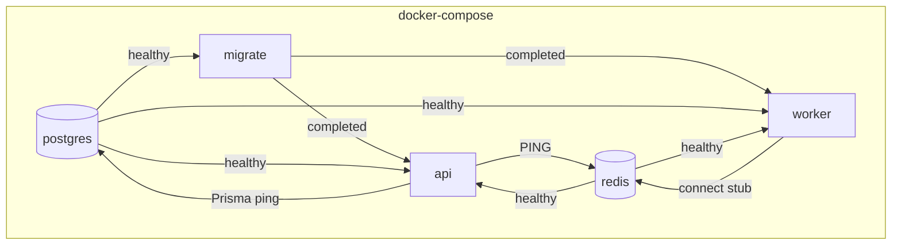
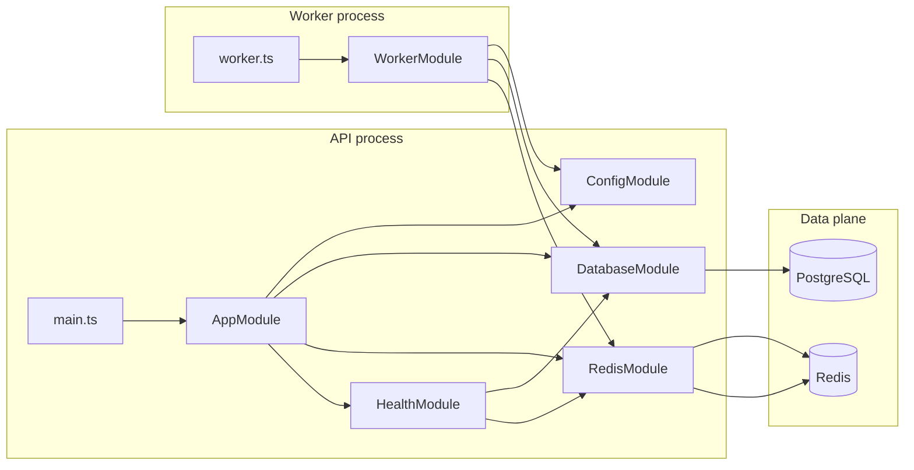

# Quantia API — Architecture Overview

Quantia is a collaborative web platform for managing research projects of the
**INNOVATEK'S / GITEMOS** research seedbed (Universidad de Cartagena).

This repository is the **backend only**: a NestJS REST API plus a BullMQ worker
process. The Next.js frontend lives in a separate repository and talks to this
API exclusively over HTTPS (`/api/v1`) and WebSocket (from F4 onward).

## Role of this API in Quantia

| Concern | Owner | Notes |
|---------|-------|-------|
| System of record | **PostgreSQL** (Supabase in prod) | Users, roles, budgets, audit logs, Notion mirror tables |
| Collaborative capture | **Notion API** (F3) | Projects, tasks, progress, documents — never budgets |
| Queues / cache / fanout | **Redis** | BullMQ jobs, Socket.io adapter (F4) |
| Async work | **Worker** | Notion sync, e-mail, PDF/Excel — never on the HTTP thread |
| AuthN / AuthZ | **API** (F1) | JWT + roles; deny-by-default |
| Storage | **Supabase Storage** (F5) | Private buckets, short-lived signed URLs only |

Invariant: the API is the **only** component that talks to Supabase, Notion and Redis.

---

## Components (F0)

| Component | What it is | Why it exists |
|-----------|------------|---------------|
| **API container** | NestJS HTTP server | Serves versioned REST under `/api/v1` |
| **Worker container** | Same image, different entrypoint | Ready for BullMQ; today only validates env and pings Redis |
| **PostgreSQL** | System of record | Local `postgres:16`; production uses Supabase |
| **Redis** | Cache / queues / fanout | Local `redis:7`; production uses managed Redis on Railway |
| **Migrate** | Ephemeral Compose service | Runs `prisma migrate deploy` before api/worker start |

### Request flow — health (F0)

```
Client → GET /api/v1/health → HealthController
  → Prisma SELECT 1 (Postgres)
  → Redis PING
  → 200 ok | 503 degraded
```

### Local orchestration

`docker-compose.yml` starts services in order:

1. `postgres` + `redis` (healthchecks)
2. `migrate` (ephemeral, `prisma migrate deploy`)
3. `api` + `worker` (wait for migrate `service_completed_successfully`)



---

## Package tree

Current repository layout after F2 domain:

```text
quantia-api/
├── .cursorrules
├── .cursor/rules/
├── .github/workflows/ci.yml
├── packages/contracts/src/
│   ├── auth.ts · pagination.ts · projects.ts · tasks.ts · progress.ts · index.ts
├── prisma/
│   ├── schema.prisma                     # Users + Projects/Tasks/Progress
│   ├── seed.ts
│   └── migrations/
│       ├── 20260915000000_init/
│       ├── 20260917000000_auth_users_roles/
│       └── 20260918000000_projects_tasks_progress/
├── src/
│   ├── main.ts · worker.ts · app.module.ts · worker.module.ts
│   ├── config/ · database/ · redis/ · health/
│   ├── auth/ · users/
│   ├── projects/ · tasks/ · progress/    # F2 domain
│   └── common/                           # Guards, filters, ProjectAccessService
├── test/                                 # auth.e2e + domain.e2e
├── docs/architecture/
│   ├── overview.md · docker.md · auth.md · domain.md
├── Dockerfile · docker-compose.yml · .env.example
├── README.md · CHANGELOG.md
```

Modules planned for later phases (siblings under `src/`):

| Phase | Folder | Quantia function |
|-------|--------|------------------|
| F1 ✓ | `src/auth/`, `src/users/` | Login, JWT, roles |
| F2 ✓ | `src/projects/`, `src/tasks/`, `src/progress/` | Core research workflow |
| F3 ✓ | `src/notion/`, jobs in worker | Bidirectional Notion ↔ Postgres sync |
| F4 | `src/realtime/` | Socket.io gateway, rooms by `projectId` |
| F5 | `src/budget/`, `src/documents/`, `src/reports/` | Financial execution, Storage, PDF/Excel |
| F6 | observability wiring | Structured logs, Railway deploy |
| F7 | seeds + OpenAPI inventory | Handoff to Security |

---

## Folder guide — what each piece does

### Entry points

| Path | Responsibility | Relates to |
|------|----------------|------------|
| [`src/main.ts`](../../src/main.ts) | Boots the Nest HTTP app, sets global prefix `api`, enables URI versioning (`/api/v1`), reads `PORT` from validated config | `AppModule` |
| [`src/worker.ts`](../../src/worker.ts) | Boots an application context (no HTTP), pings Redis, logs `Worker ready`, handles SIGINT/SIGTERM | `WorkerModule`, Redis |
| [`src/app.module.ts`](../../src/app.module.ts) | Wires Config + Database + Redis + Health for the API process | Every HTTP module |
| [`src/worker.module.ts`](../../src/worker.module.ts) | Minimal DI graph for the worker (Config + Database + Redis) | Same infra as API, no controllers |

### `src/config/` — fail-fast configuration

**Quantia rule:** the process must not start if a required env var is missing.
No silent defaults for connection strings or secrets.

| File | Function |
|------|----------|
| `env.schema.ts` | Zod schema: `NODE_ENV`, `PORT`, `DATABASE_URL`, `DIRECT_URL`, `REDIS_URL` |
| `configuration.ts` | Maps `process.env` into a typed object for `ConfigModule` |
| `config.module.ts` | Global `@nestjs/config` with `validate: validateEnv` |

`DATABASE_URL` is used by the app (pooler in production). `DIRECT_URL` is used
only for migrations (`prisma migrate deploy`), matching Supabase’s 6543 / 5432 split.

### `src/database/` — Postgres as system of record

| File | Function |
|------|----------|
| `prisma.service.ts` | Extends `PrismaClient`; connects on module init, disconnects on destroy |
| `database.module.ts` | Global module exporting `PrismaService` |

In F0 the schema only has `BootstrapMeta` so migrations and health checks work.
Domain tables arrive in F1+.

### `src/redis/` — shared infrastructure bus

| File | Function |
|------|----------|
| `redis.service.ts` | `ioredis` client; `ping()` for health; later BullMQ + Socket.io adapter |
| `redis.module.ts` | Global module exporting `RedisService` |

### `src/health/` — readiness of Quantia’s runtime dependencies

| File | Function |
|------|----------|
| `health.controller.ts` | `GET /api/v1/health` (versioned controller) |
| `indicators/prisma.health.ts` | `SELECT 1` against Postgres |
| `indicators/redis.health.ts` | `PING` → expects `PONG` |
| `health.module.ts` | Registers Terminus + indicators |

Returns **200** only when both Postgres and Redis are up; otherwise **503**.
Used by Docker `HEALTHCHECK` and by Railway rollback decisions (F6).

### `packages/contracts/` — contract before implementation

Shared package `@quantia/contracts`. In F0 it exports only `CONTRACTS_VERSION`.
From F1 onward every endpoint is born with input DTOs and response types here
so the frontend can depend on the contract while services are still stubs.

### `prisma/` — versioned schema of the system of record

| Path | Function |
|------|----------|
| `schema.prisma` | Datasource + models; `directUrl` for migrations |
| `migrations/` | Applied by the Compose `migrate` service — never manual edits in production |

### `test/` — automated verification

| Path | Function |
|------|----------|
| `health.e2e-spec.ts` | Asserts 200 + `database`/`redis` up against real services |
| `setup-e2e.ts` | Injects test env (host Postgres on **5433**, Redis on **6379**) |
| Unit `*.spec.ts` under `src/` | Env validation + Redis health failure path |

### Root ops & docs

| Path | Function |
|------|----------|
| `Dockerfile` | Multi-stage image; final stage `runner` for api/worker; target `migrate` keeps Prisma CLI |
| `docker-compose.yml` | Local one-command environment; api/worker build `target: runner`, migrate builds `target: migrate` |
| `.github/workflows/ci.yml` | Pipeline green from day one (ENG-121 / RNF-06, RNF-14) |
| `docs/` | Durable architecture and setup docs — keep them current with the code |
| `.cursorrules` / `.cursor/rules/` | Non-negotiable stack and phase rules for AI-assisted development |

---

## How pieces relate (F0)



---

## Documentation map

Use this table to know where to look (and what to update) when changing the API:

| You need to… | Read / update |
|--------------|---------------|
| Understand the product and stack lock | [`.cursorrules`](../../.cursorrules) |
| Know what belongs in the current phase | [`.cursor/rules/api-development.md`](../../.cursor/rules/api-development.md) |
| Run the stack locally | [`docs/development/local-setup.md`](../development/local-setup.md) |
| See high-level architecture (this file) | [`docs/architecture/overview.md`](./overview.md) |
| Understand Docker images and containers | [`docs/architecture/docker.md`](./docker.md) |
| Understand auth, JWT and roles (F1) | [`docs/architecture/auth.md`](./auth.md) |
| Quick start for contributors | [`README.md`](../../README.md) |
| Record user-visible changes | [`CHANGELOG.md`](../../CHANGELOG.md) |
| Env var contract | [`.env.example`](../../.env.example) |
| Track F0–F7 delivery | Linear [ENG-116](https://linear.app/brevku/issue/ENG-116) / [ENG-121](https://linear.app/brevku/issue/ENG-121) |

---

## Future phases

See [ENG-116](https://linear.app/brevku/issue/ENG-116) and
[`.cursor/rules/api-development.md`](../../.cursor/rules/api-development.md)
for F1–F7 scope and exit criteria. Do not start later-phase work until the
current phase exit criteria are met.
