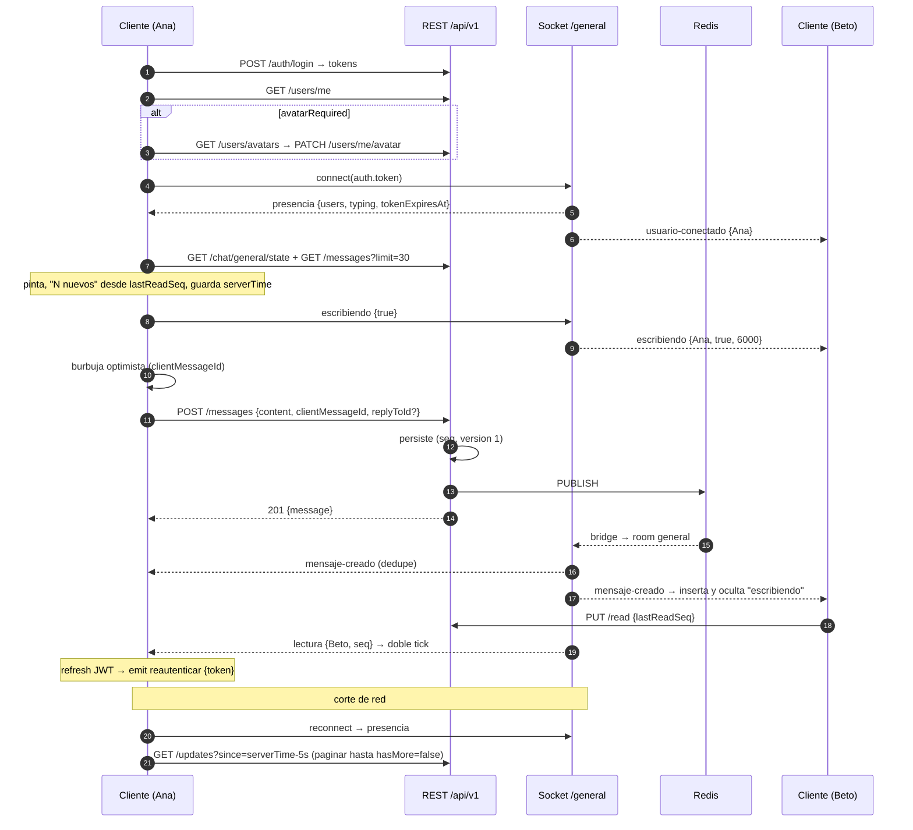

# Guía de integración E2E — API completa + Chat General v2 en tiempo real

Guía para conectar un cliente (web/móvil) con **toda** la API de Quantia y con el **Chat General** de punta a punta: login → avatar obligatorio → bootstrap → socket `/general` → enviar/editar/borrar/reaccionar/responder → typing → leídos → reconexión sin perder nada.

> "E2E" significa **de extremo a extremo** (cliente → API → Postgres/Redis → todos los clientes). **No** hay cifrado extremo a extremo: los mensajes viajan por TLS (`https`/`wss`) y se guardan en texto plano en Postgres.

Verificado con la suite automatizada contra Postgres + Redis reales: `test/chat-general-v2.e2e-spec.ts` (REST + Socket.io), `test/chat-general*.e2e-spec.ts`, `test/realtime.e2e-spec.ts` y las specs unitarias de `src/chat-general/` y `src/realtime/`.

Docs relacionados: [`chat-general.md`](../architecture/chat-general.md) (diseño) · [`realtime.md`](../architecture/realtime.md) · [`auth.md`](../architecture/auth.md) · [`inventory.md`](../architecture/inventory.md) · [`local-setup.md`](./local-setup.md) · Bruno [`bruno/chat/`](../../bruno/chat/).

---

## 1. Qué incluye el Chat General v2

| Función (estilo Telegram) | Cómo |
|---------------------------|------|
| Chat del semillero en vivo | Socket.io `/general`, room fija, auto-join |
| Avatar **obligatorio** de 5 predefinidos (sin fotos) | `GET /users/avatars`, `PATCH /users/me/avatar`; el chat responde `AVATAR_REQUIRED` hasta elegir |
| Enviar con UI optimista e idempotencia | `POST /chat/general/messages` + `clientMessageId` |
| Responder / citar | `replyToId` → `replyTo` con extracto |
| Editar (marca "editado") | `PATCH /messages/:id` (autor, ventana 48 h por defecto) |
| Borrar (autor; Admin modera) | `DELETE /messages/:id` → tombstone + evento |
| Reacciones rápidas (1 por usuario, 8 emoji) | `PUT`/`DELETE /messages/:id/reaction` |
| "Escribiendo…" | evento socket `chat.general.escribiendo` (con ack) |
| En línea / última vez | presencia Redis multi-pestaña y multi-réplica, `lastSeenAt` |
| No leídos y "visto por" | `PUT /chat/general/read`, `GET /chat/general/state`, evento `chat.general.lectura` |
| Reconexión sin huecos | `GET /chat/general/updates?since=` (feed de cambios con tombstones) |
| Orden estable y merges seguros | `seq` (orden del servidor) y `version` (último cambio gana) en cada mensaje |
| Sesión del socket alineada con el JWT | reautenticación en banda + cierre al expirar |

**No incluye** (no lo asumas): adjuntos/fotos, menciones, mensajes fijados, hilos, mensajes directos, notificaciones push, búsqueda en servidor, cifrado E2E. Enviar/editar/borrar/reaccionar es **REST**; el socket solo empuja eventos y recibe typing/reauth.

---

## 2. Configuración

### 2.1 Variables relevantes

| Variable | Default | Notas |
|----------|---------|-------|
| `CHAT_GENERAL_ENABLED` | **`true`** | Chat activo salvo que se apague (`false` = kill switch: REST 404 `CHAT_DISABLED`, socket rechazado) |
| `CHAT_GENERAL_MESSAGE_MAX_LENGTH` | `2000` | Tope real de `content` (contrato: 4000) |
| `CHAT_GENERAL_EDIT_WINDOW_SECONDS` | `172800` (48 h) | `0` = sin límite |
| `CHAT_GENERAL_TYPING_TTL_MS` | `6000` | Vida del indicador sin refresco |
| `CHAT_GENERAL_TOKEN_GRACE_SECONDS` | `30` | Gracia tras `exp` del JWT antes de cerrar el socket |
| `CHAT_GENERAL_RATE_LIMIT` | `20` | Envíos + ediciones + borrados por minuto (429 + `Retry-After`) |
| `CHAT_GENERAL_HISTORY_DEFAULT_LIMIT` / `_MAX_LIMIT` | `30` / `100` | Páginas de historial y feed |
| `CHAT_GENERAL_PRESENCE_TTL_SECONDS` / `_HEARTBEAT_SECONDS` | `60` / `20` | Presencia |
| `WS_MAX_CONNECTIONS_PER_USER` | **`10`** | Sockets por usuario (una pestaña completa abre hasta 3) |
| `WS_MAX_EVENTS_PER_SECOND` | `30` | Por socket (typing, reauth, join) |
| `CORS_ORIGINS` | — | Origen exacto del front (esquema + host + puerto); nunca `*` |

> **Railway:** `.railway/railway.ts` usa `preserve()`, así que los valores ya cargados en staging se mantienen. Si staging tiene `WS_MAX_CONNECTIONS_PER_USER=5` o `CHAT_GENERAL_ENABLED=false` explícitos, hay que cambiarlos a mano. Las variables nuevas no hacen falta (tienen default).

> **Puerto:** la API usa `:3000` por defecto; corre el front en otro (`5173`) y agrégalo a `CORS_ORIGINS`.

### 2.2 Backend local

```bash
docker compose up -d postgres redis
cp .env.example .env
npx prisma migrate deploy        # incluye 20261105000000_chat_general_v2_avatars
npm run prisma:seed
npm run start:dev
```

### 2.3 Usuarios demo

| Email | Password | Rol | Avatar inicial |
|-------|----------|-----|----------------|
| `admin@quantia.local` | `AdminPass1!` | ADMINISTRADOR | `AVATAR_01` |
| `coord@quantia.local` | `CoordPass1!` | COORDINADOR | `AVATAR_02` |
| `researcher@quantia.local` | `ResearchPass1!` | INVESTIGADOR | `AVATAR_03` |
| `researcher-b@quantia.local` | `ResearchPass1!` | INVESTIGADOR | **ninguno** (sirve para probar el selector obligatorio) |

El seed solo pone el avatar al **crear** el usuario; si el usuario lo cambia, re-sembrar no lo pisa.

### 2.4 URLs

| Entorno | REST | Socket.io |
|---------|------|-----------|
| Local | `http://localhost:3000/api/v1` | `http://localhost:3000/general` |
| Staging | `https://quantiaapi-production.up.railway.app/api/v1` | `https://quantiaapi-production.up.railway.app/general` |

### 2.5 Contratos (`@quantia/contracts` 0.8.0)

Paquete privado del workspace (publicar en registro privado, `npm link` o copiar `packages/contracts/src/`). Exporta todo lo que usa esta guía: `ChatGeneralEvent`, `ChatGeneralClientEvent`, `ChatGeneralErrorCode`, `AvatarKey`, `AVATAR_CATALOG`, `CHAT_GENERAL_REACTIONS`, schemas Zod de cada payload y tipos (`GeneralChatMessageDto`, …). Valida los eventos entrantes con los schemas si quieres blindar el cliente.

---

## 3. Mapa de toda la API

Base `/api/v1`. OpenAPI regenerado: [`openapi/openapi.json`](../../openapi/openapi.json) (ya con schemas de respuesta del chat) · Swagger `/api/docs` fuera de producción · Inventario: [`inventory.md`](../architecture/inventory.md).

| Orden | Grupo | Endpoints | Acceso |
|-------|-------|-----------|--------|
| 0 | Health | `GET /health` | Público |
| 1 | Auth | `POST /auth/login` · `/auth/refresh` · `/auth/logout` | Público (throttle `auth`) |
| 2 | Perfil | `GET /users/me` → incluye `avatar` y `avatarRequired` | JWT |
| 2 | Avatar | `GET /users/avatars` · `PATCH /users/me/avatar` | JWT (cualquier rol) |
| 3 | Chat | `GET /chat/general/state` · `GET/POST /chat/general/messages` · `PATCH/DELETE /chat/general/messages/:id` · `PUT/DELETE /chat/general/messages/:id/reaction` · `PUT /chat/general/read` · `GET /chat/general/updates` | JWT + flag + avatar |
| 3 | Chat WS | namespace `/general` | JWT en handshake + avatar |
| 4 | Proyectos | `/projects` CRUD · `/projects/:id/members` | JWT + membresía |
| 4 | Tareas / Avances | `/projects/:projectId/tasks` · `/projects/:projectId/progress` | JWT + membresía |
| 4 | Presupuesto | `/projects/:projectId/budget` (+ `/executions`) | JWT; mutaciones Admin/Coord |
| 4 | Documentos | `/projects/:projectId/documents` (multipart; descarga = URL firmada) | JWT + membresía |
| 4 | Reportes | `POST …/reports` → 202 · `GET …/reports/:id` (polling) | JWT |
| 4 | Directorio | `GET /users/directory?q=` | Admin/Coord |
| 4 | Admin usuarios | `/users` CRUD | Admin |
| WS | Dominio | `/projects` (+ `join { projectId }`) · `/notifications` | JWT |
| — | Webhook Notion | `POST /webhooks/notion` | Solo servidor-a-servidor |

**Formato de error** (todas las rutas):

```json
{ "statusCode": 403, "message": "Choose an avatar before using the chat", "code": "AVATAR_REQUIRED", "path": "/api/v1/chat/general/messages", "timestamp": "2026-11-05T12:00:00.000Z" }
```

`code` es **opcional y estable** (hoy lo envían las rutas del chat); `message` es texto para humanos. Decide en el cliente por `statusCode` + `code`, nunca por `message`. El `ValidationPipe` es estricto: propiedades extra → 400. `429` siempre trae `Retry-After` (segundos).

---

## 4. Autenticación

```text
POST /auth/login   { email, password }   → 200 { accessToken, refreshToken, tokenType, expiresIn: 900 }
POST /auth/refresh { refreshToken }      → 200 { accessToken, refreshToken, … }   (rota: guarda el nuevo)
POST /auth/logout  { refreshToken }      → 204
```

- Access JWT ≈ 15 min, `Authorization: Bearer`.
- Refresh rotativo con detección de reuso: reutilizar uno ya usado revoca la familia. Haz el refresh **single-flight** (una sola petición aunque fallen varias a la vez).
- Socket: el token va en `auth.token` del handshake. **Tras cada refresh**, envía `chat.general.reautenticar { token }` por el socket abierto (§7.3); si no, el servidor lo cierra al expirar el token + 30 s con `error { code: "TOKEN_EXPIRED" }`.

```ts
// http.ts — cliente HTTP con refresh single-flight
const API = import.meta.env.VITE_API_URL;
let accessToken = '';
let refreshToken = '';
let refreshing: Promise<void> | null = null;
const refreshListeners = new Set<(token: string) => void>();

export const onTokenRefreshed = (fn: (t: string) => void) => refreshListeners.add(fn);

export async function login(email: string, password: string) {
  const res = await fetch(`${API}/api/v1/auth/login`, {
    method: 'POST',
    headers: { 'content-type': 'application/json' },
    body: JSON.stringify({ email, password }),
  });
  if (!res.ok) throw await toApiError(res);
  ({ accessToken, refreshToken } = await res.json());
}

function refresh(): Promise<void> {
  refreshing ??= (async () => {
    const res = await fetch(`${API}/api/v1/auth/refresh`, {
      method: 'POST',
      headers: { 'content-type': 'application/json' },
      body: JSON.stringify({ refreshToken }),
    });
    if (!res.ok) throw new SessionExpiredError();
    ({ accessToken, refreshToken } = await res.json());
    refreshListeners.forEach((fn) => fn(accessToken)); // → reautenticar el socket
  })().finally(() => { refreshing = null; });
  return refreshing;
}

export async function api<T>(path: string, init: RequestInit = {}, retried = false): Promise<T> {
  const res = await fetch(`${API}/api/v1${path}`, {
    ...init,
    headers: { ...init.headers, authorization: `Bearer ${accessToken}`, 'content-type': 'application/json' },
  });
  if (res.status === 401 && !retried) { await refresh(); return api(path, init, true); }
  if (!res.ok) throw await toApiError(res); // { statusCode, code?, message, retryAfter? }
  return (res.status === 204 ? undefined : await res.json()) as T;
}

export async function getFreshAccessToken(): Promise<string> {
  const b64 = accessToken.split('.')[1].replace(/-/g, '+').replace(/_/g, '/');
  const { exp } = JSON.parse(atob(b64));
  if (exp * 1000 - Date.now() < 60_000) await refresh();
  return accessToken;
}
```

`toApiError` (lee `statusCode`, `code`, `message` y el header `Retry-After`) y `SessionExpiredError` son helpers tuyos.

---

## 5. Avatar obligatorio

1. Tras login: `GET /users/me` → `{ …, avatar: "AVATAR_03" | null, avatarRequired: boolean }`.
2. Si `avatarRequired` → muestra un selector **bloqueante** con `GET /users/avatars`:

```json
{ "items": [
  { "key": "AVATAR_01", "label": "Átomo", "color": "#4f46e5" },
  { "key": "AVATAR_02", "label": "Microscopio", "color": "#0891b2" },
  { "key": "AVATAR_03", "label": "Hoja", "color": "#16a34a" },
  { "key": "AVATAR_04", "label": "Cohete", "color": "#ea580c" },
  { "key": "AVATAR_05", "label": "Bombillo", "color": "#ca8a04" }
] }
```

3. `PATCH /users/me/avatar { "avatar": "AVATAR_04" }` → `200 UserResponse`. Cualquier otro valor (URLs, base64, …) → 400. No existe subida de fotos.
4. El cambio emite `chat.general.usuario-actualizado { user }` a quien esté en el chat → actualiza la tarjeta en presencia y en los mensajes de ese autor en memoria.

Las imágenes **las empaqueta el front** (p. ej. `/avatars/avatar-01.svg`) mapeadas por `key`; `color` sirve de placeholder/anillo mientras cargan. `avatarUrl` sigue en los payloads por compatibilidad y es siempre `null`.

Mientras no haya avatar: todas las rutas del chat → `403 { code: "AVATAR_REQUIRED" }` y el socket `/general` → `error { code: "AVATAR_REQUIRED" }` + desconexión. El resto de la API funciona normal.

---

## 6. REST del chat

Todas: Bearer · flag activo · avatar elegido. Respuestas de mensaje siempre envueltas en `{ "message": GeneralChatMessageDto }`.

### 6.1 Modelo de mensaje

```json
{
  "id": "a1b2c3d4-…",
  "seq": 1842,
  "version": 3,
  "content": "Texto plano (vacío si está borrado)",
  "clientMessageId": "6f1c2a9e-…",
  "createdAt": "2026-11-05T12:00:00.000Z",
  "updatedAt": "2026-11-05T12:03:10.000Z",
  "editedAt": "2026-11-05T12:01:00.000Z",
  "deletedAt": null,
  "author": { "id": "…", "name": "Ana", "avatar": "AVATAR_01", "avatarUrl": null },
  "replyTo": {
    "id": "…", "seq": 1840,
    "author": { "id": "…", "name": "Beto", "avatar": "AVATAR_02", "avatarUrl": null },
    "excerpt": "primeros 120 caracteres…",
    "deleted": false
  },
  "reactions": [ { "emoji": "🔥", "count": 2, "userIds": ["…", "…"] } ]
}
```

| Campo | Regla para el cliente |
|-------|-----------------------|
| `seq` | Orden canónico. **Ordena por `seq`**, nunca por relojes del cliente |
| `version` | Sube con cada edición, borrado o cambio de reacciones. Al fusionar, gana la versión mayor y se ignora un evento con versión menor o igual |
| `clientMessageId` | Eco del id que generó el cliente → reemplaza la burbuja optimista en su lugar (sin salto) |
| `editedAt` | Si no es `null`, muestra "editado" |
| `deletedAt` | Tombstone: `content: ""`, `reactions: []`, `replyTo: null`. El historial no lo incluye; el feed de cambios sí |
| `replyTo.deleted` | La cita muestra "Mensaje eliminado" (`excerpt: null`) |
| `reactions` | Orden fijo del allowlist (los chips no saltan). "Reaccioné yo" = `userIds.includes(me.id)` |
| `content` | Texto plano normalizado (NFC, sin caracteres de control ni overrides bidi). **Píntalo como texto**, nunca como HTML |

### 6.2 Endpoints

| Método y ruta | Body / query | Respuesta | Evento |
|---------------|--------------|-----------|--------|
| `GET /chat/general/state` | — | `{ serverTime, latestSeq, lastReadSeq, unreadCount, readStates[{userId,lastReadSeq}], limits{messageMaxLength,editWindowSeconds,typingTtlMs,historyMaxLimit}, reactions[] }` | — |
| `GET /chat/general/messages` | `?limit=30&cursor=` | `{ items (seq desc, sin borrados), nextCursor, hasMore }` | — |
| `POST /chat/general/messages` | `{ content, clientMessageId?, replyToId? }` | **201** nuevo · **200** reintento idempotente | `mensaje-creado` |
| `PATCH /chat/general/messages/:id` | `{ content }` | 200 `{ message }` (mismo texto = sin cambios) | `mensaje-editado` |
| `DELETE /chat/general/messages/:id` | — | **204** (idempotente) | `mensaje-eliminado` |
| `PUT /chat/general/messages/:id/reaction` | `{ emoji }` (`👍 ❤️ 😂 😮 😢 🙏 🔥 🎉`) | 200 `{ message }`; reemplaza la anterior | `reacciones-actualizadas` |
| `DELETE /chat/general/messages/:id/reaction` | — | 200 `{ message }` | `reacciones-actualizadas` |
| `PUT /chat/general/read` | `{ lastReadSeq }` | `{ lastReadSeq, unreadCount }` (solo avanza; se acota al último `seq`) | `lectura` (si avanzó) |
| `GET /chat/general/updates` | `?since=<ISO>` o `?cursor=` · `&limit=` | `{ items (por updatedAt asc, con tombstones), nextCursor, hasMore, serverTime }` | — |

Reglas de negocio:

- **Editar:** solo el autor y dentro de `editWindowSeconds` (`403 EDIT_WINDOW_EXPIRED`). Admin **no** edita mensajes ajenos.
- **Borrar:** el autor siempre; `ADMINISTRADOR` cualquiera (`byModerator: true` en el evento). Se vacía el contenido y se eliminan las reacciones.
- **Responder:** `replyToId` debe ser un mensaje vivo (`400 REPLY_TARGET_NOT_FOUND`).
- **Reacciones:** una por usuario y mensaje (como Telegram por defecto). Poner la misma otra vez = sin cambios.
- **Idempotencia:** reintentar `POST` con el mismo `clientMessageId` devuelve el original (200) y **vuelve a emitir** `mensaje-creado`, así que un fanout que falló se recupera. Los clientes deduplican por `id`.
- **Rate limit:** envíos, ediciones y borrados comparten `CHAT_GENERAL_RATE_LIMIT`/min; reacciones, leídos e historial usan el throttle general.

Códigos de error del chat (`code`): `CHAT_DISABLED` (404) · `AVATAR_REQUIRED` (403) · `UNAUTHORIZED` (403, usuario inactivo) · `MESSAGE_NOT_FOUND` (404) · `NOT_MESSAGE_AUTHOR` (403) · `EDIT_WINDOW_EXPIRED` (403) · `REPLY_TARGET_NOT_FOUND` (400) · `INVALID_PAYLOAD` (400: vacío, largo, cursor). Los 429 no traen `code`: usa `Retry-After`.

---

## 7. Socket.io `/general`

```ts
io(`${API}/general`, { transports: ['websocket'], auth: (cb) => getFreshAccessToken().then((token) => cb({ token })) })
```

### 7.1 Handshake

Orden de validación: flag → JWT → usuario activo → avatar → límite de sockets. Si algo falla, el servidor emite `error { code, message }` y desconecta:

| `code` | Qué hacer |
|--------|-----------|
| `CHAT_DISABLED` | Mostrar "chat no disponible"; no reintentar |
| `UNAUTHORIZED` | Refrescar el token; si falla, volver al login |
| `AVATAR_REQUIRED` | Abrir el selector de avatar |
| `TOO_MANY_CONNECTIONS` | Avisar "demasiadas pestañas"; reintentar con backoff largo |
| `TOKEN_EXPIRED` | Reconectar (la función `auth` trae un token nuevo) |

`connect` **no** significa listo (la autenticación es posterior). El chat está listo al recibir **`chat.general.presencia`**. Un corte del servidor llega como `disconnect` con motivo `"io server disconnect"`, que **no** reconecta solo: llama a `socket.connect()` con backoff.

### 7.2 Servidor → cliente

| Evento | Payload | Uso en UI |
|--------|---------|-----------|
| `chat.general.presencia` | `{ users[], typing[], generatedAt, tokenExpiresAt }` | Solo a ti, al conectar. Foto inicial de presencia y typing |
| `chat.general.usuario-conectado` | `{ user, occurredAt }` | Entra a "en línea" (0→1 sockets) |
| `chat.general.usuario-desconectado` | `{ userId, occurredAt, lastSeenAt }` | Sale de "en línea"; "visto por última vez" |
| `chat.general.usuario-actualizado` | `{ user, occurredAt }` | Cambió de avatar: refresca su tarjeta |
| `chat.general.mensaje-creado` | `{ message }` | Insertar (también te llega el tuyo) |
| `chat.general.mensaje-editado` | `{ message }` | Reemplazar si `version` es mayor |
| `chat.general.mensaje-eliminado` | `{ id, seq, version, deletedAt, byModerator }` | Animar colapso y quitar; marcar citas como borradas |
| `chat.general.reacciones-actualizadas` | `{ messageId, seq, version, reactions, actorId, emoji }` | Reemplazar chips; "pop" si `emoji` no es null |
| `chat.general.escribiendo` | `{ user, isTyping, expiresInMs }` | Mostrar/ocultar "escribiendo…"; ignora tu propio `user.id` |
| `chat.general.lectura` | `{ userId, lastReadSeq, readAt }` | Ticks "visto" / "visto por N" |
| `error` | `{ code, message }` | §7.1 |

### 7.3 Cliente → servidor (con ack)

| Evento | Payload | Ack |
|--------|---------|-----|
| `chat.general.escribiendo` | `{ isTyping: boolean }` | `{ ok: true }` · `{ ok: false, code: "RATE_LIMITED" \| "INVALID_PAYLOAD", error }` |
| `chat.general.reautenticar` | `{ token }` (debe ser del mismo usuario) | `{ ok: true, tokenExpiresAt }` · `{ ok: false, code: "UNAUTHORIZED" }` |

Typing: envía `true` al empezar a escribir y luego como mucho cada `typingTtlMs / 2` mientras sigas escribiendo; `false` al vaciar el campo, al perder foco o al enviar. El servidor solo reenvía el inicio y un refresco cada ~TTL/3 (no cada tecla), y en cada mensaje fija `expiresInMs`: si no llega refresco, oculta el indicador al vencer. Al desconectarse el último socket del usuario, el servidor manda `isTyping: false`. Además, al recibir `mensaje-creado` de un usuario, oculta su indicador.

---

## 8. Flujo E2E



### 8.1 Arranque

1. Login → `GET /users/me` → avatar si falta.
2. Abre el socket y **bufferiza** eventos hasta hidratar.
3. Al recibir `presencia`: carga presencia y typing.
4. `GET /chat/general/state` (no leídos, `readStates`, `limits`, `reactions`) y `GET /messages?limit=30`.
5. Aplica el buffer sobre el historial con las reglas de §9 y guarda `syncPoint = state.serverTime`.
6. Scroll arriba → `?cursor=nextCursor`. Mantén el ancla de scroll al insertar arriba.

### 8.2 Reconexión sin huecos

Al recibir de nuevo `presencia` tras un corte:

```text
GET /chat/general/updates?since=<syncPoint − 5 s>&limit=100
  repetir con ?cursor=nextCursor mientras hasMore
  aplicar cada item con la regla de version (tombstones incluidos)
syncPoint = serverTime de la última respuesta
```

Los 5 s de solape cubren escrituras concurrentes al corte; como la regla de `version` es idempotente, repetir items no hace daño. Si el corte fue muy largo (días), recarga la primera página de historial y descarta el estado viejo.

---

## 9. Reglas de estado (reducer)

```ts
import type { GeneralChatMessageDto as Msg } from '@quantia/contracts';

type Local = Msg & { status?: 'sending' | 'failed' };
const byId = new Map<string, Local>();
const pendingByClientId = new Map<string, string>(); // clientMessageId → id local

export function applyMessage(incoming: Msg) {
  const localId = incoming.clientMessageId && pendingByClientId.get(incoming.clientMessageId);
  if (localId) { byId.delete(localId); pendingByClientId.delete(incoming.clientMessageId!); }
  const current = byId.get(incoming.id);
  if (current && current.version >= incoming.version) return;   // evento viejo o repetido
  if (incoming.deletedAt) { byId.delete(incoming.id); markRepliesDeleted(incoming.id); return; }
  byId.set(incoming.id, incoming);
}

export function applyDeleted(e: { id: string; version: number }) {
  const current = byId.get(e.id);
  if (current && current.version >= e.version) return;
  byId.delete(e.id); markRepliesDeleted(e.id);
}

export function applyReactions(e: { messageId: string; version: number; reactions: Msg['reactions'] }) {
  const current = byId.get(e.messageId);
  if (!current || current.version >= e.version) return;
  byId.set(e.messageId, { ...current, reactions: e.reactions, version: e.version });
}

function markRepliesDeleted(parentId: string) {
  for (const m of byId.values())
    if (m.replyTo?.id === parentId) m.replyTo = { ...m.replyTo, deleted: true, excerpt: null };
}

export const sorted = () => [...byId.values()].sort((a, b) => a.seq - b.seq);
```

La burbuja optimista usa `seq: Number.MAX_SAFE_INTEGER` (va al final) y `status: 'sending'`; al llegar la respuesta o el evento con su `clientMessageId` se reemplaza por la real. Si `POST` falla con 5xx o red, reintenta con el **mismo** `clientMessageId`; con 4xx márcala `failed`. Cuando un mensaje se edita, actualiza también `excerpt` de las respuestas que lo citan en memoria (el servidor no reescribe citas antiguas).

---

## 10. Cliente de referencia

```ts
import { io, type Socket } from 'socket.io-client';
import {
  ChatGeneralClientEvent as C, ChatGeneralErrorCode as E, ChatGeneralEvent as Ev,
  type ChatGeneralAck, type GeneralChatStateResponse, type GeneralChatHistoryResponse,
  type GeneralChatUpdatesResponse, type GeneralChatMessageEnvelope, type PresenceUser,
} from '@quantia/contracts';
import { api, getFreshAccessToken, onTokenRefreshed } from './http';
import { applyMessage, applyDeleted, applyReactions } from './reducer';

export class GeneralChat {
  socket!: Socket;
  online = new Map<string, PresenceUser>();
  typing = new Map<string, number>();           // userId → timer
  readStates = new Map<string, number>();       // userId → lastReadSeq
  state?: GeneralChatStateResponse;
  private syncPoint?: string;
  private hydrated = false;
  private buffer: Array<() => void> = [];
  private retries = 0;
  private typingSentAt = 0;

  constructor(private me: PresenceUser, private render: () => void) {}

  connect() {
    this.socket = io(`${import.meta.env.VITE_API_URL}/general`, {
      transports: ['websocket'],
      auth: (cb) => { void getFreshAccessToken().then((token) => cb({ token })); },
    });
    const later = (fn: () => void) => (this.hydrated ? fn() : this.buffer.push(fn));

    this.socket.on(Ev.PRESENCIA, async (p) => {
      this.retries = 0;
      this.online = new Map(p.users.map((u: PresenceUser) => [u.id, u]));
      p.typing.forEach((u: PresenceUser) => this.showTyping(u.id, this.state?.limits.typingTtlMs ?? 6000));
      await (this.syncPoint ? this.catchUp() : this.bootstrap());
      this.buffer.splice(0).forEach((fn) => fn());
      this.hydrated = true;
      this.render();
    });
    this.socket.on(Ev.USUARIO_CONECTADO, ({ user }) => { this.online.set(user.id, user); this.render(); });
    this.socket.on(Ev.USUARIO_DESCONECTADO, ({ userId }) => { this.online.delete(userId); this.hideTyping(userId); this.render(); });
    this.socket.on(Ev.USUARIO_ACTUALIZADO, ({ user }) => { if (this.online.has(user.id)) this.online.set(user.id, user); this.render(); });
    this.socket.on(Ev.MENSAJE_CREADO, ({ message }) => later(() => { applyMessage(message); this.hideTyping(message.author.id); this.render(); }));
    this.socket.on(Ev.MENSAJE_EDITADO, ({ message }) => later(() => { applyMessage(message); this.render(); }));
    this.socket.on(Ev.MENSAJE_ELIMINADO, (e) => later(() => { applyDeleted(e); this.render(); }));
    this.socket.on(Ev.REACCIONES_ACTUALIZADAS, (e) => later(() => { applyReactions(e); this.render(); }));
    this.socket.on(Ev.LECTURA, ({ userId, lastReadSeq }) => { this.readStates.set(userId, lastReadSeq); this.render(); });
    this.socket.on(Ev.ESCRIBIENDO, ({ user, isTyping, expiresInMs }) => {
      if (user.id === this.me.id) return;
      isTyping ? this.showTyping(user.id, expiresInMs) : this.hideTyping(user.id);
      this.render();
    });

    this.socket.on('error', (e: { code: string }) => {
      if (e.code === E.CHAT_DISABLED || e.code === E.AVATAR_REQUIRED) this.retries = Infinity;
    });
    this.socket.on('disconnect', (reason) => {
      this.hydrated = false;
      if (reason !== 'io server disconnect' || this.retries === Infinity) return;
      const wait = Math.min(1000 * 2 ** this.retries++, 30_000);
      setTimeout(() => this.socket.connect(), wait);
    });

    // Mantener vivo el socket tras cada refresh del JWT (sin parpadeo de presencia).
    onTokenRefreshed((token) => {
      void this.socket.timeout(5000).emitWithAck(C.REAUTENTICAR, { token }).catch(() => undefined);
    });
  }

  private async bootstrap() {
    this.state = await api<GeneralChatStateResponse>('/chat/general/state');
    this.state.readStates.forEach((r) => this.readStates.set(r.userId, r.lastReadSeq));
    const page = await api<GeneralChatHistoryResponse>('/chat/general/messages?limit=30');
    page.items.forEach(applyMessage);
    this.syncPoint = this.state.serverTime;
  }

  private async catchUp() {
    let since = new Date(Date.parse(this.syncPoint!) - 5000).toISOString();
    let cursor: string | null = null;
    let res: GeneralChatUpdatesResponse;
    do {
      const q = cursor ? `cursor=${encodeURIComponent(cursor)}` : `since=${encodeURIComponent(since)}`;
      res = await api<GeneralChatUpdatesResponse>(`/chat/general/updates?${q}&limit=100`);
      res.items.forEach(applyMessage);
      cursor = res.nextCursor;
    } while (res.hasMore);
    this.syncPoint = res.serverTime;
  }

  send(content: string, replyToId?: string) {
    const clientMessageId = crypto.randomUUID();
    // → insertar optimista (status 'sending', seq MAX_SAFE_INTEGER) y luego:
    void this.stopTyping();
    return api<GeneralChatMessageEnvelope>('/chat/general/messages', {
      method: 'POST', body: JSON.stringify({ content, clientMessageId, replyToId }),
    }).then(({ message }) => applyMessage(message));
  }
  edit = (id: string, content: string) =>
    api<GeneralChatMessageEnvelope>(`/chat/general/messages/${id}`, { method: 'PATCH', body: JSON.stringify({ content }) })
      .then(({ message }) => applyMessage(message));
  remove = (id: string) => api<void>(`/chat/general/messages/${id}`, { method: 'DELETE' });
  react = (id: string, emoji: string) =>
    api<GeneralChatMessageEnvelope>(`/chat/general/messages/${id}/reaction`, { method: 'PUT', body: JSON.stringify({ emoji }) })
      .then(({ message }) => applyMessage(message));
  unreact = (id: string) =>
    api<GeneralChatMessageEnvelope>(`/chat/general/messages/${id}/reaction`, { method: 'DELETE' })
      .then(({ message }) => applyMessage(message));

  /** Llamar en cada input; envía como mucho cada TTL/2. */
  onInput(text: string) {
    if (!text) return void this.stopTyping();
    const ttl = this.state?.limits.typingTtlMs ?? 6000;
    if (Date.now() - this.typingSentAt < ttl / 2) return;
    this.typingSentAt = Date.now();
    void this.socket.emitWithAck(C.ESCRIBIENDO, { isTyping: true }).then((ack: ChatGeneralAck) => ack);
  }
  stopTyping() {
    if (!this.typingSentAt) return;
    this.typingSentAt = 0;
    return this.socket.emitWithAck(C.ESCRIBIENDO, { isTyping: false });
  }

  /** Llamar (con debounce ~1 s) con el seq del último mensaje visible. */
  markRead = (seq: number) =>
    api<{ lastReadSeq: number; unreadCount: number }>('/chat/general/read', { method: 'PUT', body: JSON.stringify({ lastReadSeq: seq }) });

  private showTyping(userId: string, ms: number) {
    clearTimeout(this.typing.get(userId));
    this.typing.set(userId, window.setTimeout(() => { this.typing.delete(userId); this.render(); }, ms));
  }
  private hideTyping(userId: string) { clearTimeout(this.typing.get(userId)); this.typing.delete(userId); }
}
```

---

## 11. Animaciones fluidas (qué te da el backend para cada una)

| Efecto | Dato del backend | Recomendación |
|--------|------------------|---------------|
| Enviar sin salto | `clientMessageId` + respuesta/eco con el mismo id | La burbuja optimista conserva su `key` de React/Vue: usa `clientMessageId ?? id` como key para que el swap no remonte el nodo |
| Estados ⏱ → ✓ → ✓✓ | `status` local → respuesta 201 → `lectura` / `readStates` | ✓✓ cuando algún otro usuario tiene `lastReadSeq >= msg.seq`; "visto por N" = cuántos |
| Inserción ordenada | `seq` | Inserta por `seq` (FLIP/layout animation); nunca reordenes por reloj local |
| "N mensajes nuevos" | `state.lastReadSeq`, `unreadCount` | Divisor antes del primer `seq > lastReadSeq` ajeno |
| Agrupar burbujas | `author.id` + `createdAt` | Mismo autor y < 5 min → misma burbuja-grupo; avatar solo en la última |
| Separadores de día | `createdAt` (UTC ISO) | Formatea en la zona del usuario; usa `serverTime` para corregir el desfase del reloj |
| Editar (crossfade) | `mensaje-editado` + `version` | Anima solo si `version` sube; muestra "editado" con `editedAt` |
| Borrar (colapso) | `mensaje-eliminado` | Anima altura → 0 y luego quita; con `byModerator` muestra "eliminado por moderación" en tus propios mensajes |
| Reacción "pop" | `reacciones-actualizadas` (`actorId`, `emoji`) | Pop/burst solo en el chip de `emoji`; si `actorId === me.id` ya animaste al tocar (UI optimista) |
| Escribiendo… | `escribiendo` (`expiresInMs`) | Tres puntos con fade; timer por usuario con `expiresInMs`; varios: "Ana y Beto están escribiendo" |
| Entrar/salir en línea | `usuario-conectado/desconectado` (0→1 / último socket) | Sin parpadeo multi-pestaña: el servidor ya deduplica |
| Cargar más antiguos | `nextCursor` | Conserva el ancla de scroll (mide la altura antes y después de insertar) |
| Citas | `replyTo.excerpt`, `replyTo.seq` | Tap → scroll al `seq`; si no está cargado, pagina hasta encontrarlo |

Todos los eventos traen el **objeto completo** (no hace falta refetch para animar) y son **idempotentes** bajo la regla de `version`, así que puedes animar en cuanto llegan sin miedo a duplicados.

---

## 12. Pruebas rápidas

```bash
TOKEN=$(curl -sS -X POST http://localhost:3000/api/v1/auth/login -H 'content-type: application/json' \
  -d '{"email":"researcher@quantia.local","password":"ResearchPass1!"}' | node -pe 'JSON.parse(require("fs").readFileSync(0)).accessToken')
export TOKEN
```

Escuchar todo (terminal 1):

```bash
node -e "
const { io } = require('socket.io-client');
const s = io('http://127.0.0.1:3000/general', { auth: { token: process.env.TOKEN }, transports: ['websocket'] });
s.onAny((e, p) => console.log(e, JSON.stringify(p)));
s.on('chat.general.presencia', () => s.emit('chat.general.escribiendo', { isTyping: true }, console.log));
"
```

Enviar, editar, reaccionar y borrar (terminal 2):

```bash
MID=$(curl -sS -X POST http://localhost:3000/api/v1/chat/general/messages -H "authorization: Bearer $TOKEN" \
  -H 'content-type: application/json' -d '{"content":"hola","clientMessageId":"curl-1"}' | node -pe 'JSON.parse(require("fs").readFileSync(0)).message.id')
```

```bash
curl -sS -X PATCH "http://localhost:3000/api/v1/chat/general/messages/$MID" -H "authorization: Bearer $TOKEN" -H 'content-type: application/json' -d '{"content":"hola (editado)"}'
```

```bash
curl -sS -X PUT "http://localhost:3000/api/v1/chat/general/messages/$MID/reaction" -H "authorization: Bearer $TOKEN" -H 'content-type: application/json' -d '{"emoji":"🔥"}'
```

```bash
curl -sS -X DELETE "http://localhost:3000/api/v1/chat/general/messages/$MID" -H "authorization: Bearer $TOKEN" -o /dev/null -w '%{http_code}\n'
```

Avatar obligatorio: inicia sesión con `researcher-b@quantia.local` y llama `GET /chat/general/messages` → `403 AVATAR_REQUIRED`; después `PATCH /users/me/avatar` y repite.

Bruno: carpeta [`bruno/chat/`](../../bruno/chat/) + `users/Avatars` y `users/Set My Avatar` (`Send Message` guarda `messageId` para el resto).

Suite automatizada:

```bash
npm run test:e2e -- --testPathPatterns='chat-general|realtime'
```

---

## 13. Riesgos y límites que siguen vigentes

| # | Tema | Detalle | Mitigación |
|---|------|---------|------------|
| 1 | CORS y WebSocket | Con `transports: ['websocket']` el upgrade no pasa por el middleware CORS; la protección real es el JWT | Mantener JWT corto (15 min) y la reautenticación/expiración del socket |
| 2 | Tarjeta en typing tras cambiar avatar | El socket guarda la tarjeta del usuario al conectar o reautenticar; el avatar de sus eventos de typing se actualiza en la siguiente reautenticación | El cliente aplica `usuario-actualizado` sobre su mapa de usuarios y pinta typing con ese mapa |
| 3 | Orden de commit vs `updatedAt` | Dos escrituras simultáneas pueden confirmarse fuera del orden de su `updatedAt` por milisegundos | Solape de 5 s en `since` + regla de `version` (idempotente) |
| 4 | `reactions[].userIds` | Lista completa de quién reaccionó; crece con el número de usuarios | Adecuado para el tamaño del semillero; si crece, paginar "quién reaccionó" |
| 5 | Borrado | Se vacía el contenido en BD (no hay "papelera" ni recuperación) | Intencional por privacidad; la fila queda como tombstone para sincronizar |
| 6 | Railway `preserve()` | Valores viejos de staging (`WS_MAX_CONNECTIONS_PER_USER=5`, flag) no se sobrescriben solos | Revisar variables en Railway antes de desplegar |

Corregido en v2 respecto a la revisión anterior: contadores de sockets "fantasma" tras redeploys (ZSET con heartbeat + `enableShutdownHooks`), límite de 5 sockets (ahora 10), mensaje persistido sin fanout (el reintento re-emite), socket vivo con token expirado (cierre a `exp` + gracia), OpenAPI sin schemas de respuesta del chat.

---

## 14. Checklist

**Backend**

- [ ] Migración `20261105000000_chat_general_v2_avatars` aplicada (`prisma migrate deploy`).
- [ ] `CHAT_GENERAL_ENABLED` no está en `false`; `WS_MAX_CONNECTIONS_PER_USER` ≥ 10 en Railway.
- [ ] `CORS_ORIGINS` con el origen exacto del front.

**Cliente**

- [ ] Selector de avatar bloqueante cuando `avatarRequired`; manejo de `AVATAR_REQUIRED` en REST y socket.
- [ ] Refresh single-flight + `chat.general.reautenticar` tras cada refresh.
- [ ] Listo al recibir `presencia`; buffer de eventos hasta hidratar.
- [ ] Orden por `seq`, merge por `version`, swap optimista por `clientMessageId`.
- [ ] Reconexión con `/updates?since=` (solape 5 s) paginando hasta `hasMore=false`.
- [ ] Typing con throttle TTL/2, `false` al enviar/vaciar, expiración local por `expiresInMs`.
- [ ] `PUT /read` con debounce; divisor "nuevos"; ticks con `readStates` + `lectura`.
- [ ] Editar solo propios dentro de `limits.editWindowSeconds`; borrar propios (Admin: todos).
- [ ] Reacciones del allowlist `state.reactions`; una por usuario.
- [ ] Texto renderizado como texto plano; 429 con `Retry-After`.

**Verificación manual**

- [ ] Dos navegadores: enviar, responder, editar, reaccionar, borrar → el otro lo ve animado sin recargar.
- [ ] Cortar la red de uno 30 s mientras el otro edita y borra → al volver queda igual que el otro.
- [ ] Dejar el chat abierto más de 15 min → sigue conectado (reautenticación) sin parpadeo de presencia.
- [ ] Usuario sin avatar → selector; tras elegir, entra al chat y los demás ven su avatar.
