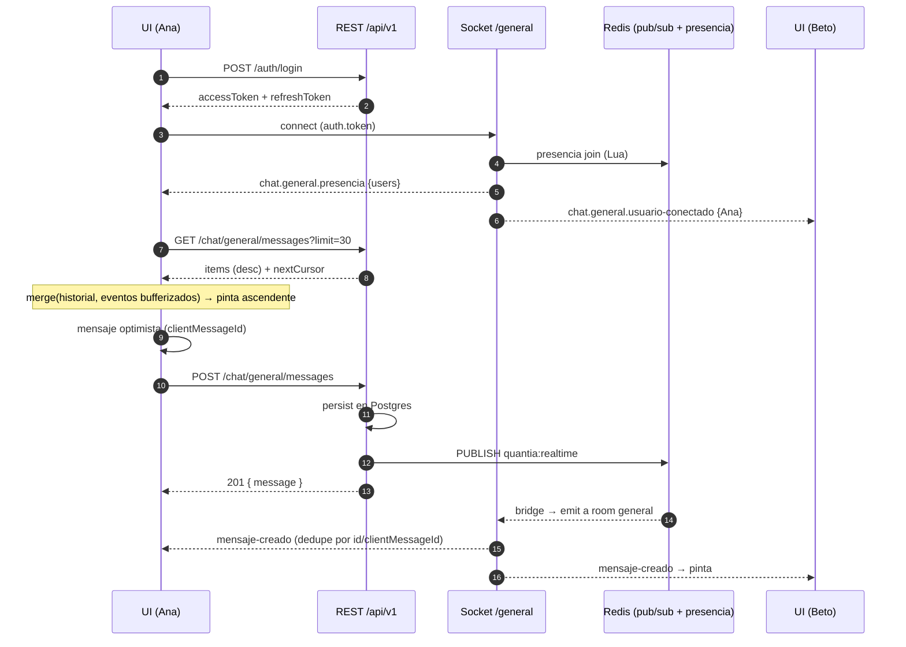

# Guía de integración E2E — API completa + Chat General en tiempo real

Guía para conectar un cliente (web/móvil) con **toda** la API de Quantia y, en particular, con el **Chat General** de punta a punta: login → historial REST → socket `/general` → envío → recepción en vivo → reconexión.

> "E2E" aquí significa **de extremo a extremo** (cliente → API → Postgres/Redis → todos los clientes). **No** hay cifrado extremo a extremo de mensajes: viajan por TLS (`https`/`wss`) y se guardan en texto plano en Postgres (`general_chat_messages.content`).

Estado verificado leyendo el código y las suites e2e existentes (`test/chat-general*.e2e-spec.ts`, `test/realtime.e2e-spec.ts`). Esta guía **no** fue contrastada contra un servidor en ejecución.

Docs relacionados: [`chat-general.md`](../architecture/chat-general.md) (diseño) · [`realtime.md`](../architecture/realtime.md) · [`auth.md`](../architecture/auth.md) · [`inventory.md`](../architecture/inventory.md) (rutas) · [`local-setup.md`](./local-setup.md).

---

## 1. ¿Está integrado el chat?

**Sí.** El Chat General está implementado, registrado en `AppModule` y cubierto por tests. No hay nada que "activar" en código; solo configuración.

| Pieza | Dónde | Estado |
|-------|-------|--------|
| REST `POST`/`GET /api/v1/chat/general/messages` | `src/chat-general/` | Implementado |
| Namespace Socket.io `/general` (auto-join a room `general`) | `src/realtime/general-realtime.gateway.ts` | Implementado |
| Presencia en Redis (multi-pestaña, multi-réplica, TTL + reconciliación) | `src/realtime/chat-general-presence.service.ts` | Implementado |
| Fanout `RealtimeEmitter` → Redis `quantia:realtime` → `RealtimeBridge` → room | `src/realtime/` | Implementado |
| Persistencia `general_chat_messages` (soft-delete, idempotencia) | `prisma/migrations/20260925200000_*` | Implementado |
| Contratos (`chat.general.*`, schemas Zod) | `packages/contracts/src/chat-general.ts` | Implementado |
| Feature flag | `CHAT_GENERAL_ENABLED` (default `false` en el schema; `true` en `.env.example`) | Configuración |
| Tests unit + e2e (REST, WS, 2 instancias) | `test/chat-general*.e2e-spec.ts`, `test/realtime.e2e-spec.ts` | Presentes (CI) |

**Lo que el chat NO tiene** (no lo asumas en el cliente):

- Enviar por socket: el gateway `/general` **no escucha eventos del cliente**. Enviar = `POST` REST; recibir = socket.
- Editar/borrar mensajes (la columna `deletedAt` existe, pero no hay endpoint).
- Typing indicators, confirmaciones de lectura, mensajes directos, adjuntos, avatares (`avatarUrl` siempre `null`).
- Listado REST de usuarios en línea: la presencia solo llega por socket.
- Replay de eventos perdidos mientras el socket estuvo caído (se resuelve re-consultando el historial, §6.5).

---

## 2. Prerrequisitos y configuración

### 2.1 Variables que afectan al cliente

| Variable | Valor local típico | Por qué importa al chat |
|----------|--------------------|-------------------------|
| `CHAT_GENERAL_ENABLED` | `true` | `false` → REST **404** y el WS se rechaza |
| `CORS_ORIGINS` | origen exacto del front (`http://localhost:5173`) | Allowlist CSV para HTTP y Socket.io; nunca `*`; incluir esquema + puerto |
| `CORS_VERCEL_PREVIEW` | `true` solo en staging | Permite `https://<sub>.vercel.app`; la API aborta el arranque si es `true` con `APP_ENV=production` |
| `PORT` | `3000` | Ver aviso de puerto abajo |
| `REDIS_URL` | `redis://localhost:6379` | Fanout y presencia; sin Redis el chat en vivo no funciona |
| `JWT_ISSUER` / `JWT_AUDIENCE` | `quantia-api` / `quantia-clients` | Se validan también en el handshake WS |
| `WS_MAX_CONNECTIONS_PER_USER` | `5` (default) | **Ver §7**: puede bloquear al abrir varias pestañas |
| `CHAT_GENERAL_MESSAGE_MAX_LENGTH` | `2000` | Tope real de `content` (el contrato admite hasta 4000) |
| `CHAT_GENERAL_RATE_LIMIT` | `20` | `POST` por minuto por usuario → 429 |

> **Aviso de puerto:** `.env.example` fija `PORT=3000` **y** `CORS_ORIGINS=http://localhost:3000,...`. Si tu front también corre en `:3000` choca con la API. Usa otro puerto para el front (Vite `5173`, etc.) y agrégalo a `CORS_ORIGINS`.

### 2.2 Levantar el backend local

```bash
docker compose up -d postgres redis
cp .env.example .env            # revisar CHAT_GENERAL_ENABLED=true y CORS_ORIGINS
npx prisma migrate deploy
npm run prisma:seed             # usuarios demo (ver §2.3)
npm run start:dev               # API en http://localhost:3000
```

Compose publica Postgres en **`5433`**; ajusta `DATABASE_URL`/`DIRECT_URL` si corres la API fuera de Docker (ver [`local-setup.md`](./local-setup.md)). Smoke: `GET http://localhost:3000/api/v1/health`.

### 2.3 Usuarios de prueba (seed)

| Email | Password | Rol |
|-------|----------|-----|
| `admin@quantia.local` | `AdminPass1!` | ADMINISTRADOR |
| `coord@quantia.local` | `CoordPass1!` | COORDINADOR |
| `researcher@quantia.local` | `ResearchPass1!` | INVESTIGADOR |
| `researcher-b@quantia.local` | `ResearchPass1!` | INVESTIGADOR |

Cualquier rol autenticado y activo puede usar el chat. No hay auto-registro: las cuentas las crea un Admin con `POST /users`.

### 2.4 URLs base

| Entorno | REST | Socket.io |
|---------|------|-----------|
| Local | `http://localhost:3000/api/v1` | `http://localhost:3000/general` |
| Staging (Railway) | `https://quantiaapi-production.up.railway.app/api/v1` | `https://quantiaapi-production.up.railway.app/general` |

Los namespaces **no** llevan prefijo `/api` ni `/v1`; el path de transporte es el default `/socket.io/`.

### 2.5 Contratos compartidos

`@quantia/contracts` (0.7.0) es un paquete **privado** del workspace (`private: true`). Para usarlo en el front hay que publicarlo en un registro privado, vincularlo (`npm link`/workspace) o copiar `packages/contracts/src/`. Exporta nombres de evento, schemas Zod y helpers (`ChatGeneralEvent`, `RealtimeNamespace`, `generalChatMessageSchema`, `generalRoom`…). Los ejemplos de abajo lo usan; si no lo tienes, reemplaza por los strings literales de §5.

---

## 3. Mapa de la API (qué conectar y en qué orden)

Base: `/api/v1`. Inventario canónico: [`inventory.md`](../architecture/inventory.md) · OpenAPI: [`openapi/openapi.json`](../../openapi/openapi.json) (los endpoints del chat no declaran schema de respuesta ahí; usa esta guía) · Swagger en `/api/docs` solo con `NODE_ENV !== production`.

| Orden | Grupo | Endpoints | Acceso | Notas de integración |
|-------|-------|-----------|--------|----------------------|
| 0 | Health | `GET /health` | Público | Readiness Postgres + Redis |
| 1 | Auth | `POST /auth/login` · `POST /auth/refresh` · `POST /auth/logout` | Público | Ver §4. Throttle propio (10/min por defecto) |
| 2 | Perfil | `GET /users/me` | JWT | Pinta nombre/roles tras login |
| 3 | Chat REST | `GET`/`POST /chat/general/messages` | JWT + flag | Ver §5 |
| 3 | Chat WS | namespace `/general` | JWT en handshake | Ver §5–§6 |
| 4 | Proyectos | `GET/POST /projects` · `GET/PATCH/DELETE /projects/:id` · `POST /projects/:id/members` · `DELETE /projects/:id/members/:userId` | JWT + membresía | Listados `page`/`pageSize` → `{ data, meta }` |
| 4 | Tareas | `/projects/:projectId/tasks[/:taskId]` | JWT + membresía | CRUD |
| 4 | Avances | `/projects/:projectId/progress[/:progressId]` | JWT + membresía | CRUD |
| 4 | Presupuesto | `/projects/:projectId/budget` · `/budget/executions` | JWT; mutaciones Admin/Coord | |
| 4 | Documentos | `/projects/:projectId/documents` (+ `/:id/download`) | JWT + membresía | Upload `multipart/form-data`; descarga = URL firmada de vida corta |
| 4 | Reportes | `POST /projects/:projectId/reports` → **202** · `GET …/reports/:reportId` | JWT | Generación async; hacer polling hasta tener URL firmada |
| 4 | Directorio | `GET /users/directory?q=` | JWT + Admin/Coord | `q` mínimo 2 caracteres |
| 4 | Admin usuarios | `/users` CRUD | JWT + Admin | |
| — | Webhook Notion | `POST /webhooks/notion` | Público + HMAC | **Solo servidor-a-servidor**; el front no lo usa |
| WS | Dominio | `/projects` (+ `join { projectId }`), `/notifications` | JWT en handshake | Eventos `tarea.actualizada`, `avance.registrado`, `proyecto.retrasado`, `presupuesto.ejecucion-baja` |

**Formato de error HTTP** (todos los endpoints):

```json
{ "statusCode": 400, "message": "content must not be empty", "path": "/api/v1/chat/general/messages", "timestamp": "2026-11-05T12:00:00.000Z" }
```

`message` es siempre un `string` (los errores de validación vienen unidos con `, `). El `ValidationPipe` es estricto (`whitelist` + `forbidNonWhitelisted`): **cualquier propiedad extra en el body devuelve 400**.

**Códigos que el cliente debe manejar:** `400` validación · `401` token ausente/expirado · `403` rol/membresía · `404` recurso o flag apagado · `413` body grande (límite JSON `1mb`) · `429` con header `Retry-After` (segundos; expuesto por CORS) · `5xx`.

---

## 4. Autenticación (REST y WS comparten el mismo access token)

```text
POST /api/v1/auth/login    { email, password }
→ 200 { accessToken, refreshToken, tokenType: "Bearer", expiresIn: 900 }

POST /api/v1/auth/refresh  { refreshToken }
→ 200 { accessToken, refreshToken, ... }     # el refresh ROTA: guarda el nuevo y descarta el viejo

POST /api/v1/auth/logout   { refreshToken }
→ 204
```

Reglas que condicionan el cliente:

1. **Access JWT ≈ 15 min** (`JWT_ACCESS_TTL`). REST: `Authorization: Bearer <accessToken>`.
2. **Refresh rotativo con detección de reuso.** Reutilizar un refresh ya consumido revoca **toda la familia** (→ 401, hay que volver a loguear). Por eso las renovaciones deben ser **single-flight**: si varias peticiones reciben 401 a la vez, dispara **un solo** `/auth/refresh` y que las demás esperen su resultado (esta carrera fue el hallazgo QX-P5-001).
3. **WebSocket:** el token se envía en `handshake.auth.token`. Los navegadores no pueden poner headers en un WebSocket, así que no uses `Authorization` allí (el servidor lo acepta como fallback solo para clientes no-navegador).
4. **El JWT se valida solo al conectar.** Un socket ya abierto sigue autenticado aunque el access expire o el usuario se desactive. No hay re-auth en caliente: al reconectar hay que presentar un token **vigente** (§6.4).
5. Guarda el `refreshToken` fuera de `localStorage` si el front lo permite (cookie `httpOnly` propia del BFF, memoria, o storage seguro en móvil).

### Cliente HTTP mínimo con refresh single-flight (TypeScript)

`toApiError` (parsea el JSON de error de §3) y `SessionExpiredError` son helpers tuyos; no vienen en `@quantia/contracts`.

```ts
const API = import.meta.env.VITE_API_URL; // p. ej. http://localhost:3000

let accessToken = '';
let refreshToken = '';
let refreshing: Promise<void> | null = null;

export async function login(email: string, password: string) {
  const res = await fetch(`${API}/api/v1/auth/login`, {
    method: 'POST',
    headers: { 'content-type': 'application/json' },
    body: JSON.stringify({ email, password }),
  });
  if (!res.ok) throw await toApiError(res);
  ({ accessToken, refreshToken } = await res.json());
}

function refresh(): Promise<void> {
  refreshing ??= (async () => {
    const res = await fetch(`${API}/api/v1/auth/refresh`, {
      method: 'POST',
      headers: { 'content-type': 'application/json' },
      body: JSON.stringify({ refreshToken }),
    });
    if (!res.ok) throw new SessionExpiredError(); // volver a /login
    ({ accessToken, refreshToken } = await res.json());
  })().finally(() => { refreshing = null; });
  return refreshing;
}

export async function api(path: string, init: RequestInit = {}, retried = false): Promise<Response> {
  const res = await fetch(`${API}/api/v1${path}`, {
    ...init,
    headers: { ...init.headers, authorization: `Bearer ${accessToken}`, 'content-type': 'application/json' },
  });
  if (res.status === 401 && !retried) {
    await refresh();
    return api(path, init, true);
  }
  return res;
}

// Para el socket (§6): devuelve un access token vigente, renovándolo si le quedan <30 s.
export async function getFreshAccessToken(): Promise<string> {
  const b64 = accessToken.split('.')[1].replace(/-/g, '+').replace(/_/g, '/'); // JWT = base64url
  const { exp } = JSON.parse(atob(b64));
  if (exp * 1000 - Date.now() < 30_000) await refresh();
  return accessToken;
}
```

---

## 5. Contrato del Chat General

### 5.1 REST

Auth: Bearer. Cualquier rol activo. Flag apagado → **404**.

#### `POST /api/v1/chat/general/messages`

```json
// request
{ "content": "Hola semillero", "clientMessageId": "6f1c2a9e-0b7d-4a55-9e0e-2f6a1d3c8b11" }
```

- `content`: string, se hace `trim`, 1 – `CHAT_GENERAL_MESSAGE_MAX_LENGTH` (default 2000; tope duro del contrato 4000).
- `clientMessageId` (opcional pero **recomendado**): 1–64 chars; clave de idempotencia **por autor** (`UNIQUE(authorId, clientMessageId)`). Un `randomUUID()` (36 chars) sirve.

```json
// 201 Created (primera vez) · 200 OK (reintento con el mismo clientMessageId)
{
  "message": {
    "id": "a1b2c3d4-e5f6-7890-abcd-ef1234567890",
    "content": "Hola semillero",
    "clientMessageId": "6f1c2a9e-0b7d-4a55-9e0e-2f6a1d3c8b11",
    "createdAt": "2026-11-05T12:00:00.000Z",
    "author": { "id": "1111…", "name": "Ana Investigadora", "avatarUrl": null }
  }
}
```

> **La respuesta viene envuelta en `{ message }`.** Así lo devuelve el controlador y así lo verifica `test/chat-general.e2e-spec.ts`. El ejemplo de `chat-general.md` mostraba el DTO sin envolver; ya está corregido.

Errores: `400` (vacío, demasiado largo, propiedad extra) · `401` · `404` (flag) · `429` (+`Retry-After`).

#### `GET /api/v1/chat/general/messages?limit=30&cursor=<nextCursor>`

```json
{
  "items": [ /* GeneralChatMessageDto, del MÁS NUEVO al MÁS ANTIGUO */ ],
  "nextCursor": "MjAyNi0xMS0wNVQxMjowMDowMC4wMDBafGExYjJjM2Q0…",
  "hasMore": true
}
```

- Orden **descendente** (`createdAt desc, id desc`): `items[0]` es el último mensaje. Para pintar el chat, invierte el arreglo.
- `nextCursor` apunta hacia atrás (mensajes más viejos); es **opaco** (base64url de `createdAt|id`), no lo construyas. `null` cuando `hasMore=false`.
- `limit`: default 30, máx 100 (`CHAT_GENERAL_HISTORY_*`). Cursor inválido → `400`.
- Paginación por cursor (no `page`/`pageSize`) a propósito: el feed es append-only.

### 5.2 Socket.io — namespace `/general`

| Aspecto | Valor |
|---------|-------|
| URL | `<API>/general` (ej. `http://localhost:3000/general`) |
| Auth | `auth: { token: <accessToken> }` |
| Transporte | `transports: ['websocket']` (obligatorio en cuanto haya >1 réplica; hoy Railway corre 1 réplica) |
| Room | `general` (`CHAT_GENERAL_ROOM`), **auto-join** al conectar; el cliente no emite `join` |
| Eventos cliente → servidor | **Ninguno** |

Eventos servidor → cliente (nombres exactos, `ChatGeneralEvent`):

| Evento | Payload | Cuándo |
|--------|---------|--------|
| `chat.general.presencia` | `{ users: PresenceUser[], generatedAt }` | **Solo al socket que se conecta**, una vez, tras autenticar y unirse |
| `chat.general.usuario-conectado` | `{ user: PresenceUser, occurredAt }` | Cuando un usuario pasa de 0 → 1 sockets (a toda la room, incluido él mismo) |
| `chat.general.usuario-desconectado` | `{ userId, occurredAt }` | Cuando se cierra el **último** socket de ese usuario |
| `chat.general.mensaje-creado` | `{ message: GeneralChatMessageDto }` | Tras persistir un `POST`; a **toda** la room, **incluido el emisor** |
| `error` | `{ message }` | Antes de desconectar si el chat está apagado o se superó el límite de conexiones |

`PresenceUser = { id, name, avatarUrl: string | null }` — nunca email, roles ni tokens.

Peculiaridades del handshake (derivadas de `general-realtime.gateway.ts`):

- La autenticación ocurre **después** de que Socket.io ya aceptó el namespace. Un token inválido/ausente **no** produce `connect_error`: el cliente ve `connect` y casi de inmediato `disconnect` con motivo `"io server disconnect"`. Por eso `connect` **no** significa "autenticado": considera el chat listo cuando llega **`chat.general.presencia`**.
- `"io server disconnect"` **desactiva la reconexión automática** del cliente Socket.io; hay que llamar a `socket.connect()` a mano.

---

## 6. Flujo E2E y cliente de referencia

### 6.1 Secuencia completa



### 6.2 Orden de arranque recomendado

1. `login` → `GET /users/me` (guarda `id` propio para marcar "mis mensajes").
2. Abre el socket y **empieza a bufferizar** `mensaje-creado`.
3. Al llegar `chat.general.presencia` → estado `ready`; pinta usuarios en línea.
4. `GET /chat/general/messages?limit=30`; fusiona con lo bufferizado (por `id`), ordena ascendente por `createdAt` (desempate `id`) y vacía el buffer.
5. Scroll hacia arriba → siguiente página con `nextCursor`.

Abrir el socket **antes** del `GET` evita la ventana en la que un mensaje se persiste entre el historial y la suscripción.

### 6.3 Cliente de referencia (TypeScript + socket.io-client)

```ts
import { io, type Socket } from 'socket.io-client';
import {
  ChatGeneralEvent,
  type GeneralChatMessageDto,
  type GeneralChatHistoryResponse,
  type ChatGeneralPresenciaPayload,
  type ChatGeneralUsuarioConectadoPayload,
  type ChatGeneralUsuarioDesconectadoPayload,
  type ChatGeneralMensajeCreadoPayload,
  type PresenceUser,
} from '@quantia/contracts';
import { api, getFreshAccessToken } from './http'; // §4

type Status = 'connecting' | 'ready' | 'reconnecting' | 'disabled' | 'unauthorized';

export class GeneralChat {
  private socket!: Socket;
  private messages = new Map<string, GeneralChatMessageDto>(); // por id
  private pending = new Map<string, string>();                 // clientMessageId → id optimista
  private online = new Map<string, PresenceUser>();
  private buffer: GeneralChatMessageDto[] = [];
  private hydrated = false;
  private retries = 0;
  status: Status = 'connecting';

  constructor(private onChange: () => void) {}

  connect() {
    this.socket = io(`${import.meta.env.VITE_API_URL}/general`, {
      transports: ['websocket'],
      // función → se evalúa en CADA (re)conexión con un token vigente
      auth: (cb) => { void getFreshAccessToken().then((token) => cb({ token })); },
      reconnection: true,
      reconnectionDelay: 1_000,
      reconnectionDelayMax: 10_000,
    });

    this.socket.on(ChatGeneralEvent.PRESENCIA, (p: ChatGeneralPresenciaPayload) => {
      this.retries = 0;
      this.online = new Map(p.users.map((u) => [u.id, u]));
      void this.hydrate().then((ok) => {
        if (ok) this.status = 'ready';
        this.onChange();
      });
    });
    this.socket.on(ChatGeneralEvent.USUARIO_CONECTADO, (p: ChatGeneralUsuarioConectadoPayload) => {
      this.online.set(p.user.id, p.user); this.onChange();
    });
    this.socket.on(ChatGeneralEvent.USUARIO_DESCONECTADO, (p: ChatGeneralUsuarioDesconectadoPayload) => {
      this.online.delete(p.userId); this.onChange();
    });
    this.socket.on(ChatGeneralEvent.MENSAJE_CREADO, ({ message }: ChatGeneralMensajeCreadoPayload) => {
      if (!this.hydrated) this.buffer.push(message); else this.upsert(message);
      this.onChange();
    });

    // El servidor avisa el motivo justo antes de cortar.
    this.socket.on('error', (e: { message: string }) => {
      if (/not enabled/i.test(e.message)) this.status = 'disabled';
      // 'Too many connections' → ver §7
    });

    this.socket.on('disconnect', (reason) => {
      this.hydrated = false;           // al volver, se re-hidrata (§6.5)
      if (this.status !== 'disabled') this.status = 'reconnecting';
      if (reason === 'io server disconnect' && this.status !== 'disabled') {
        // El cliente NO reintenta solo en este caso: backoff manual con tope.
        const wait = Math.min(1_000 * 2 ** this.retries++, 30_000);
        if (this.retries > 6) { this.status = 'unauthorized'; this.onChange(); return; }
        setTimeout(() => this.socket.connect(), wait);
      }
      this.onChange();
    });
  }

  /**
   * Historial + buffer → estado consistente. También se usa tras reconectar.
   * Ejemplo simplificado: trae solo la primera página (ver §6.5 para cortes largos).
   */
  private async hydrate(): Promise<boolean> {
    const res = await api('/chat/general/messages?limit=30');
    if (res.status === 404) { this.status = 'disabled'; return false; }
    if (!res.ok) return false;       // la UI puede reintentar / mostrar error
    const page: GeneralChatHistoryResponse = await res.json();
    for (const m of page.items) this.upsert(m);
    for (const m of this.buffer.splice(0)) this.upsert(m);
    this.hydrated = true;
    return true;
  }

  private upsert(m: GeneralChatMessageDto) {
    // Reemplaza el mensaje optimista si este es el eco/confirmación del mío.
    const optimisticId = m.clientMessageId ? this.pending.get(m.clientMessageId) : undefined;
    if (optimisticId) { this.messages.delete(optimisticId); this.pending.delete(m.clientMessageId!); }
    this.messages.set(m.id, m);
  }

  /** Lista lista para pintar (ascendente). */
  get list(): GeneralChatMessageDto[] {
    return [...this.messages.values()].sort(
      (a, b) => a.createdAt.localeCompare(b.createdAt) || a.id.localeCompare(b.id),
    );
  }

  async send(content: string, me: PresenceUser) {
    const clientMessageId = crypto.randomUUID();
    const optimisticId = `local:${clientMessageId}`;
    this.pending.set(clientMessageId, optimisticId);
    this.messages.set(optimisticId, {
      id: optimisticId, content, clientMessageId,
      createdAt: new Date().toISOString(), author: me,
    });
    this.onChange();

    try {
      const res = await api('/chat/general/messages', {
        method: 'POST',
        body: JSON.stringify({ content, clientMessageId }),
      });
      if (res.status === 201 || res.status === 200) {
        this.upsert((await res.json()).message);          // 200 = reintento idempotente
      } else if (res.status === 429) {
        const wait = Number(res.headers.get('Retry-After') ?? 5);
        throw new RateLimited(wait);                      // deshabilita el input `wait` s
      } else {
        throw await toApiError(res);
      }
    } catch (err) {
      this.messages.delete(optimisticId); this.pending.delete(clientMessageId);
      this.onChange();
      throw err;       // 5xx/red: reintentar con el MISMO clientMessageId, no uno nuevo
    }
    this.onChange();
  }

  disconnect() { this.socket?.disconnect(); }
}
```

Puntos clave del diseño:

- **Dedupe:** el emisor recibe su propio `mensaje-creado` y la respuesta del `POST`; llegan en cualquier orden. `upsert` indexa por `id` y sustituye el optimista por `clientMessageId`, así que da igual cuál llegue primero.
- **`clientMessageId` siempre:** convierte los reintentos en idempotentes (200 con el mismo mensaje).
- **Usuarios en línea:** `presencia` es la foto inicial; luego aplica `usuario-conectado/desconectado` como deltas. Una persona con 3 pestañas aparece **una vez**.

### 6.4 Renovación del token y el socket

- El socket abierto no se cae al expirar el access (solo se valida en el handshake), pero **cada reconexión** necesita un token vigente. Pasar `auth` como **función** (arriba) hace que Socket.io la evalúe en cada intento y reutilice `getFreshAccessToken()`.
- No cierres/abras el socket cada vez que refrescas el token: no hace falta y generaría parpadeo de presencia.
- Al hacer logout: `POST /auth/logout` y `socket.disconnect()`.
- Si el refresh falla (401 de `/auth/refresh`) → sesión muerta: desconecta el socket y vuelve al login.

### 6.5 Reconexión sin perder mensajes

Mientras el socket estuvo caído **no hay replay**. Al volver a recibir `presencia` (que llega en cada conexión nueva), `hydrate()` vuelve a pedir `GET …?limit=30` y fusiona por `id`. Si el corte fue largo y la primera página no solapa con lo que ya tienes (`hasMore=true` y ningún `id` conocido), sigue pidiendo con `nextCursor` hasta encontrar solapamiento o hasta un máximo razonable (p. ej. 5 páginas).

### 6.6 Probar rápido sin front (Node)

```bash
TOKEN=$(curl -sS -X POST http://localhost:3000/api/v1/auth/login \
  -H 'content-type: application/json' \
  -d '{"email":"researcher@quantia.local","password":"ResearchPass1!"}' | node -pe 'JSON.parse(require("fs").readFileSync(0)).accessToken')
export TOKEN
```

Escuchar (terminal 1):

```bash
node -e "
const { io } = require('socket.io-client');
const s = io('http://127.0.0.1:3000/general', { auth: { token: process.env.TOKEN }, transports: ['websocket'] });
for (const e of ['chat.general.presencia','chat.general.usuario-conectado','chat.general.usuario-desconectado','chat.general.mensaje-creado','error','disconnect'])
  s.on(e, (p) => console.log(e, JSON.stringify(p)));
"
```

Enviar (terminal 2) — el listener debe imprimir `chat.general.mensaje-creado`:

```bash
curl -sS -X POST http://localhost:3000/api/v1/chat/general/messages \
  -H "authorization: Bearer $TOKEN" -H 'content-type: application/json' \
  -d '{"content":"hola desde curl","clientMessageId":"curl-001"}'
```

Repetir el mismo `curl` devuelve **200** con el mismo `id` y **no** emite un segundo evento.

Pruebas negativas útiles: sin `Authorization` → 401; sin `auth.token` en el socket → `disconnect` (`io server disconnect`); 21 `POST` en un minuto → 429 con `Retry-After`.

La batería automatizada equivalente: `npm run test:e2e -- --testPathPatterns='chat-general|realtime'` (requiere Postgres + Redis).

### 6.7 Bruno

`bruno/Chat Create Message.bru` existe pero está incompleto (`body: none`, sin ejemplo) y no hay request de historial. Hasta completarlo, usa los `curl` de arriba.

---

## 7. Riesgos conocidos al integrar (hallazgos de la revisión)

Son comportamientos reales del código actual, no hipótesis. Ninguno se corrigió en esta revisión (solo documentación).

| # | Hallazgo | Impacto en el cliente | Mitigación |
|---|----------|-----------------------|------------|
| 1 | **Límite de sockets por usuario = 5** y cada pestaña completa abre hasta 3 (`/projects`, `/notifications`, `/general`) | Con 2 pestañas completas (6 sockets) la última conexión se rechaza con `error: "Too many connections"` + `disconnect`. Puede caer justo `/general` | Subir `WS_MAX_CONNECTIONS_PER_USER` (≥ 9) o conectar solo los namespaces que la vista usa; compartir un socket entre pestañas (`SharedWorker`/`BroadcastChannel`). El doc de chat ya sugiere 8 |
| 2 | El contador `ws:conn:<userId>` solo se libera en `handleDisconnect`. `main.ts` **no** llama a `enableShutdownHooks()` (solo el worker maneja `SIGTERM`) | Tras un redeploy/crash de Railway pueden quedar sockets "fantasma" en Redis que cuentan contra el límite (la clave expira a 24 h pero se renueva en cada conexión nueva). Un usuario podría quedar bloqueado con `Too many connections` aunque no tenga sockets reales | Borrar `ws:conn:<userId>` en Redis como remedio operativo; recomendable corregirlo en backend (hooks de shutdown / TTL por socket). Mostrar un mensaje claro en la UI para el caso `Too many connections` |
| 3 | Si el `POST` persiste el mensaje pero falla la publicación a Redis, responde 5xx. El reintento con el mismo `clientMessageId` devuelve **200 sin volver a emitir** (`returns existing message on P2002 without re-emitting`) | Los demás clientes no ven ese mensaje en vivo; lo verán en la siguiente hidratación del historial | Reintentar siempre con el mismo `clientMessageId`; refrescar historial periódicamente o al volver el foco de la pestaña |
| 4 | Con `transports: ['websocket']` el `upgrade` no pasa por el middleware CORS de Socket.io | La allowlist `CORS_ORIGINS` **no** protege el socket; la protección real es el JWT. No confíes en CORS como control del WS | Mantener JWT corto y validado; no relajar `iss/aud` |
| 5 | El socket no re-valida el token ni el estado del usuario tras conectar | Un usuario desactivado o con token expirado sigue recibiendo mensajes hasta que se desconecte | Forzar `disconnect` + login en el cliente al recibir 401 de refresh; backend: desconexión forzada al desactivar (no implementado) |
| 6 | Los endpoints del chat no tienen schema de respuesta en OpenAPI | Generadores de clientes (`openapi-typescript`, etc.) producirán `unknown` | Usar `@quantia/contracts` (`generalChatMessageSchema`, `generalChatHistoryResponseSchema`) para tipar/validar |
| 7 | La documentación previa mostraba el `POST` sin envolver en `{ message }` | Un cliente basado en ese ejemplo leería `undefined` | Corregido en `chat-general.md` y en esta guía |

---

## 8. Checklist de integración

**Backend / entorno**

- [ ] `CHAT_GENERAL_ENABLED=true` y migración `20260925200000_chat_general_messages` aplicada.
- [ ] `CORS_ORIGINS` contiene el origen exacto del front (esquema + host + puerto); el front no corre en el mismo puerto que la API.
- [ ] Redis accesible (`/health` OK).
- [ ] `WS_MAX_CONNECTIONS_PER_USER` dimensionado a los namespaces × pestañas esperados (§7-1).

**Cliente**

- [ ] Login + refresh **single-flight**; el refresh nuevo reemplaza al anterior.
- [ ] Socket: `transports: ['websocket']`, `auth` como función, namespace `/general`.
- [ ] El chat se considera "listo" al recibir `chat.general.presencia`, no en `connect`.
- [ ] Reconexión manual con backoff cuando el motivo es `io server disconnect`; estados `disabled` / `unauthorized` en la UI.
- [ ] Historial en orden descendente invertido para pintar; paginación con `nextCursor` opaco.
- [ ] `clientMessageId` en todo envío; dedupe por `id`/`clientMessageId`; reintento con el mismo id.
- [ ] Manejo de `429` con `Retry-After`, `400` (vacío/largo/propiedad extra), `404` (flag), `401` (refresh).
- [ ] Re-hidratar historial tras cada reconexión.
- [ ] Presencia: snapshot + deltas; una persona = una entrada.

**Verificación**

- [ ] Dos navegadores/usuarios: A envía → B ve el mensaje en vivo sin recargar.
- [ ] Cerrar la red de A 30 s, mandar mensajes desde B, restaurar → A los recupera.
- [ ] Esperar > 15 min con el chat abierto, forzar reconexión → vuelve a conectar con token renovado.
- [ ] Apagar el flag en staging → la UI muestra "chat no disponible" sin bucles de reconexión.
