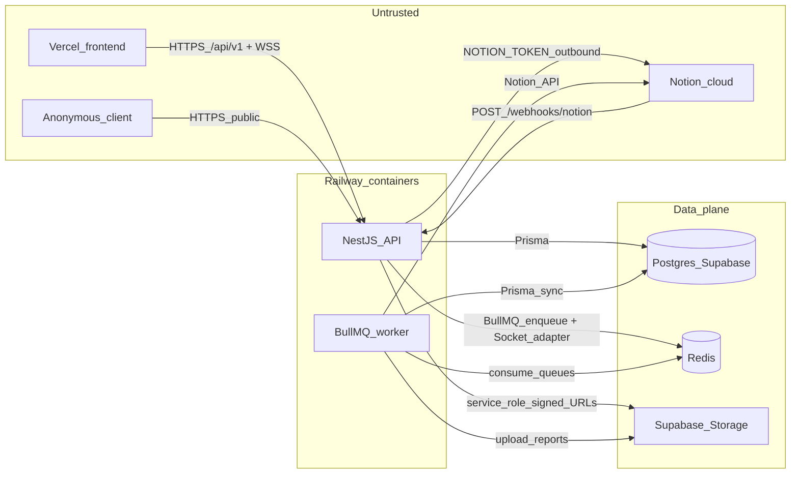

# S1 — Threat model and attack surface (ENG-127)

| Field | Value |
|-------|--------|
| Linear | [ENG-127](https://linear.app/brevku/issue/ENG-127/s1-modelado-de-amenazas-y-superficie-de-ataque) |
| Parent | [ENG-117](https://linear.app/brevku/issue/ENG-117/seguridad-quantia-seguridad-de-la-api-s1-s6) |
| Notion | [Quantia — Seguridad de la API](https://app.notion.com/p/891a93fd625a4ae7bfed0c9ed6649a26) |
| Framework | OWASP API Security Top 10 (2023) + OWASP ASVS L1–L2 |
| Method | STRIDE per trust boundary; severity = impact × likelihood |
| Owner | Julián Espitia |
| Status | S1–S5 controls for T-01…T-05, T-11, T-12, T-14, T-17, T-20 (authz of T-10/T-13); T-04 throttling complete in S5 |
| Inputs | [`inventory.md`](../architecture/inventory.md), [`handoff-security.md`](../architecture/handoff-security.md), OpenAPI [`openapi/openapi.json`](../../openapi/openapi.json) |

**Scope:** functionally frozen API (F7). S1 documents what is exposed and where each high-severity threat is mitigated. No hardening code in this phase.

**Severity scale:** Impact and Likelihood each rated High / Medium / Low. Combined severity is **High** if either factor is High and the other is at least Medium, or both High; **Medium** if both Medium or one High and one Low; **Low** otherwise.

---

## 1. Asset inventory

| ID | Asset | C / I / D | Location | Why it matters |
|----|--------|-----------|----------|----------------|
| A-01 | User credentials (password hashes, argon2) | C | Postgres `users` | Account takeover |
| A-02 | Access JWT + refresh tokens / families | C | Client + Postgres `refresh_tokens` | Session hijack, family replay |
| A-03 | `JWT_ACCESS_SECRET` / `JWT_REFRESH_SECRET` | C | Container env (Railway) | Forge any token |
| A-04 | Budget and financial execution | C / I | Postgres only (`budgets`, `budget_items`, `budget_executions`) | Fraud, seedbed financial integrity (RF-09 / RF-18) |
| A-05 | Project documents / evidence | C / I | Supabase Storage `quantia-documents` + metadata `documents` | Cross-seedbed / cross-project leak |
| A-06 | Generated reports (PDF/Excel) | C | Supabase Storage `quantia-reports` + `reports` | Same as A-05; resource cost |
| A-07 | Notion integration token (`NOTION_TOKEN`) | C | Container env | Workspace-wide Notion access |
| A-08 | Notion webhook secret (`NOTION_WEBHOOK_SECRET` = handshake `verification_token`) | C | Container env | Spoof sync events |
| A-09 | Supabase `SUPABASE_SERVICE_ROLE_KEY` | C | Container env | Bypass Storage/RLS via privileged API |
| A-10 | `DATABASE_URL` / `DIRECT_URL` | C | Container env | Full DB read/write |
| A-11 | `REDIS_URL` | C / I | Container env | Queue/job injection, session fan-out abuse |
| A-12 | Sync / audit trails (`sync_events`, `audit_logs`) | I / D | Postgres | Repudiation, cover tracks |
| A-13 | Role assignments (`user_roles`) | I | Postgres | Privilege escalation |
| A-14 | Private storage buckets (policy) | C | Supabase Storage | Unsigned public access would expose A-05/A-06 |

---

## 2. Entry inventory (attack surface)

Canonical route/event/job tables live in [`inventory.md`](../architecture/inventory.md). Summary for threat modelling:

| Surface | Path / channel | Auth today | Notes |
|---------|----------------|------------|--------|
| REST public | `GET /api/v1/health`, `POST /api/v1/auth/*` | `@Public` | Login/refresh/logout |
| REST protected | `/api/v1/users`, `projects`, `tasks`, `progress`, `budget`, `documents`, `reports` | JWT + `RolesGuard` + project membership | Financial never mirrored to Notion |
| REST webhook | `POST /api/v1/webhooks/notion` | `@Public` + HMAC / verification handshake | Enqueues BullMQ; must not call Notion on HTTP thread |
| WebSocket | `/projects`, `/notifications` | JWT in `handshake.auth.token` | Rooms by `projectId` / `user:{id}` |
| Uploads | `POST .../documents` multipart | JWT + membership | `MimeGuardService`, private bucket, signed download |
| Container env | Railway service env | Ops access | All A-03, A-07–A-11 |
| Docs / clients | Committed OpenAPI + Bruno; Swagger UI only if `NODE_ENV !== 'production'` | Staging uses `NODE_ENV=production` → no Swagger UI | Inventory for attackers via repo |

Worker surfaces (not HTTP, but trust-adjacent): BullMQ queues `notion-sync`, `reports` consuming Redis jobs produced by the API.

---

## 3. Actors

| Actor | Trust level | Capabilities assumed |
|-------|-------------|----------------------|
| Anonymous | Untrusted | Hit public routes, fuzz paths, spoof webhook without secret |
| Investigador | Authenticated, project-scoped | CRUD within membership; must not see other projects’ data |
| Coordinador | Authenticated, multi-project | Portfolio create/manage; still object-scoped |
| Administrador | Authenticated, elevated | User admin + cross-project; still must not leak secrets |
| Notion (external) | Semi-trusted after signature | Push page change events; must not become an open write channel |
| Worker (BullMQ) | Trusted process, same secrets | Sync Notion ↔ DB, generate reports; compromised worker = full A-07–A-11 |

---

## 4. Trust boundaries (DFD)

| Boundary ID | From → To | Primary risks |
|-------------|-----------|---------------|
| TB-01 | Client ↔ API | AuthN/Z, injection, BOLA, abuse |
| TB-02 | Notion ↔ API webhook | Spoofing, replay, DoS enqueue |
| TB-03 | API ↔ Postgres | SQLi, over-privileged queries, secret in DSN |
| TB-04 | API/Worker ↔ Redis | Job tampering, fan-out abuse |
| TB-05 | API/Worker ↔ Storage | Path traversal, unsigned URLs, cross-object read |
| TB-06 | API/Worker ↔ Notion API | Token leak, unsafe consumption of Notion payloads |
| TB-07 | Ops ↔ Container env | Secret exposure in images, logs, git |

---

## 5. STRIDE by trust boundary

### TB-01 — Client ↔ API

| STRIDE | Example threat |
|--------|----------------|
| S | Stolen/forged JWT; `alg: none` |
| T | Mass assignment (`role`, `ownerId`); tampered budget amounts |
| R | Actions without durable `audit_logs` |
| I | Response DTOs leaking password hashes / Notion ids |
| D | Brute login, unbounded pagination, mass report generation |
| E | BFLA (researcher → admin routes); BOLA across projects |

### TB-02 — Notion ↔ webhook

| STRIDE | Example threat |
|--------|----------------|
| S | Forged `X-Notion-Signature` or stolen `verification_token` |
| T | Crafted page ids to overwrite mirror rows |
| R | Sync without `sync_events` trail |
| I | Logging plaintext `verification_token` during handshake |
| D | Flood of webhook events → queue/DB pressure |
| E | Webhook used as unauthenticated write into Postgres via worker |

### TB-03 — API ↔ Postgres

| STRIDE | Example threat |
|--------|----------------|
| S | Attacker with leaked `DATABASE_URL` |
| T | Raw SQL / ORM bypass |
| R | Missing audit on financial writes |
| I | Error messages leaking table/column names |
| D | Expensive unscoped queries |
| E | Nest connection bypasses RLS (no `FORCE`) — app must enforce authz |

### TB-04 — API/Worker ↔ Redis

| STRIDE | Example threat |
|--------|----------------|
| S | Attacker with `REDIS_URL` enqueues forged jobs |
| T | Mutate job payload mid-flight |
| D | Flood Socket.io via Redis adapter / job storms |
| E | Worker privileges via malicious job type |

### TB-05 — Storage

| STRIDE | Example threat |
|--------|----------------|
| S | Guessing or leaking signed URLs |
| T | Upload executable / polyglot MIME; path traversal in filename |
| I | Document of project B via id of project A |
| D | Oversized multipart exhausting memory (`memoryStorage`) |
| E | Using `service_role` from a compromised client (must never leave API) |

### TB-06 — Notion API outbound

| STRIDE | Example threat |
|--------|----------------|
| I | Token in logs/repo |
| T | Malicious Notion content stored then reflected unsafely |
| D | Hitting Notion without rate limit → 429 storms in worker |

### TB-07 — Container / secrets

| STRIDE | Example threat |
|--------|----------------|
| I | `.env` / tokens committed; secrets in image layers |
| E | Root container, debug tools in prod image |
| S | Misconfigured CORS `*` (schema already forbids `*`) |

---

## 6. Threat matrix

Owner for all rows: **Julián**. Phases map to Linear children of ENG-117.

| ID | Threat | STRIDE | Actor | Asset | Impact | Likelihood | Severity | Planned control | Phase | Linear | OWASP |
|----|--------|--------|-------|-------|--------|------------|----------|-----------------|-------|--------|-------|
| T-01 | BOLA: Investigador A reads/writes project B by id | E / I | Investigador | A-04, A-05, projects | High | High | **High** | Object-level membership filter on every id query; e2e cross-user 403 | S2 **done** | [ENG-128](https://linear.app/brevku/issue/ENG-128) | API1 |
| T-02 | BFLA: researcher hits admin `/users` or coordinator-only writes | E | Investigador | A-13 | High | Medium | **High** | `RolesGuard` deny-by-default; role tests → 403; author-or-manager on task/progress mutate | S2 **done** | ENG-128 | API5 |
| T-03 | Broken auth: forged/expired JWT, `alg: none`, refresh reuse | S / E | Anonymous | A-02, A-03 | High | Medium | **High** | HS256 + iss/aud validation; rotating refresh + family revoke; logout persists revoke | S2 **done** | ENG-128 | API2 |
| T-04 | Login brute force / user enumeration | S / D / I | Anonymous | A-01 | High | High | **High** | Progressive lockout per account+IP (S2); generic errors; Redis auth throttler 10/60s (S5) | S2 + **S5 done** | ENG-128, [ENG-131](https://linear.app/brevku/issue/ENG-131) | API2, API4 |
| T-05 | WebSocket join without valid JWT or without membership | S / E | Anonymous / Investigador | A-05 rooms | High | Medium | **High** | Handshake JWT (HS256+iss/aud) + membership before `socket.join`; CORS via adapter allowlist | S2 **done** | ENG-128 | API1, API2 |
| T-06 | Spoof Notion webhook (missing/invalid signature) | S / T | Anonymous | A-08, sync | High | Medium | **High** | HMAC verify, constant-time compare, reject unsigned events | S4 **done** | [ENG-130](https://linear.app/brevku/issue/ENG-130) | API10 |
| T-07 | Replay / out-of-window Notion webhook events | T / D | Anonymous | sync DB | Medium | Medium | **Medium** | Timestamp window + Redis SET NX replay dedupe | S4 **done** | ENG-130 | API10 |
| T-08 | Leak of Notion `verification_token` via logs or response misuse | I | Ops / Anonymous | A-08 | High | Medium | **High** | No plaintext handshake log; Pino redact; rotate secret; env only | S4 **done** | ENG-130 | API8 |
| T-09 | Leak of `NOTION_TOKEN` / `service_role` / JWT secrets (repo, image, logs) | I | Ops / Insider | A-03, A-07, A-09 | High | Medium | **High** | Secrets only in Railway env; gitleaks CI; no secrets in image; Pino redaction | S4 **done** | ENG-130 | API8 |
| T-10 | Cross-project / cross-seedbed document download | E / I | Investigador | A-05, A-14 | High | Medium | **High** | Membership check (S2) + private buckets + short-lived signed URLs (S3 **done**) | S2 + S3 **done** | ENG-128, [ENG-129](https://linear.app/brevku/issue/ENG-129) | API1, API3 |
| T-11 | Upload abuse: spoofed MIME, oversized file, path traversal filename | T / D | Investigador | A-05, host | High | Medium | **High** | Content MIME allowlist, multer size cap, UUID rename, sanitized originalName | S3 **done** | ENG-129 | API3, API4 |
| T-12 | Mass assignment / property-level overexposure on write or read | T / I | Authenticated | A-13, entities | High | Medium | **High** | ValidationPipe whitelist; response DTOs; generic report errors; keep syncStatus for UI | S3 **done** | ENG-129 | API3 |
| T-13 | Tamper budget amounts or skip financial role checks | T / E | Investigador | A-04 | High | Medium | **High** | Service-level role rules + `@Roles` on writes (S2) + audit; no Notion replica | S2 **authz done** + S3/S5 | ENG-128, ENG-129 | API1, API6 |
| T-14 | Unbounded resource use: pagination, report spam, WS flood | D | Authenticated | Hobby plan, A-06 | High | High | **High** | Redis `ThrottlerModule`; pageSize ≤50; body 1mb/depth 10; report 5/60s; WS conn/event/idle caps | **S5 done** | ENG-131 | API4 |
| T-15 | Security misconfiguration: no helmet/HSTS, tech headers, weak CORS | I / S | Anonymous | platform | Medium | High | **High** | `helmet()`, disable `X-Powered-By`, strict CORS allowlist + Vercel preview pattern | S4 **done** | ENG-130 | API8 |
| T-16 | Swagger / inventory exposure in wrong environment | I | Anonymous | API surface | Medium | Low | **Medium** | Swagger off when `NODE_ENV=production`; OpenAPI committed for pentest | S4 **done** (+ S5 inventory) | ENG-130, ENG-131 | API9 |
| T-17 | Error leakage: stack traces, table names, versions on 500 | I | Anonymous | schema | Medium | Medium | **Medium** | Global filter; Multer/Prisma mapped; sanitized JSON errors | S3 **done** | ENG-129 | API8 |
| T-18 | SQLi / ORM bypass on search/filter/sort | T / I | Authenticated | A-10 | High | Low | **Medium** | Parameterised Prisma only; ban raw SQL without bound params + comment | S3 **compliant** | ENG-129 | — (injection) |
| T-19 | Compromised Redis → forged sync/report jobs | S / T | Attacker w/ A-11 | A-07, A-05 | High | Low | **Medium** | Network isolation; Redis auth; no untrusted job sources | S4 **documented** | ENG-130 | API8 |
| T-20 | Missing / incomplete audit on sensitive actions | R | Insider / attacker | A-12, A-04 | Medium | Medium | **Medium** | Broad audit paths + await DENIED; sanitize metadata; PG append-only trigger | **S5 done** | ENG-131 | API6 / RF-18 |
| T-21 | SSRF if future URL-fetch features | T / I | Authenticated | internal net | Medium | Low | **Low** | No user URL fetch today; reserved allowlist + private-range block | S3 **reserved** | ENG-129 | API7 |
| T-22 | RLS bypass via publishable Supabase keys from browser | E / I | Anonymous | A-04–A-06 | High | Low | **Medium** | Keep RLS enabled + revoke anon/authenticated; never ship service_role to client | S4 **done** (RLS F7 + docs) | ENG-130 | API8 |

### Critical scenarios (explicit coverage)

| Scenario (Notion / ENG-127) | Matrix IDs |
|-----------------------------|------------|
| Horizontal escalation between projects (BOLA) | T-01, T-05, T-10 |
| Notion webhook spoofing | T-06, T-07, T-08 |
| Integration token leak | T-08, T-09 |
| Access to another seedbed’s documents | T-10, T-11, T-22 |

---

## 7. Control plan by phase (traceability)

| Phase | Linear | Threats owned (High first) | Exit contribution from S1 |
|-------|--------|----------------------------|---------------------------|
| S2 Identity | ENG-128 | T-01, T-02, T-03, T-04*, T-05, T-10*, T-13* | AuthN/Z + object checks |
| S3 Data | ENG-129 | T-10*, T-11, T-12, T-13*, T-17, T-18, T-21 | DTOs, uploads, errors |
| S4 Infra / secrets | ENG-130 | T-06, T-07, T-08, T-09, T-15, T-16*, T-19, T-22 | Webhook, helmet, secrets, container — see [`infra-hardening.md`](./infra-hardening.md) |
| S5 Resilience | ENG-131 | T-04*, T-14, T-16*, T-20 | Rate limit, audit, WS quotas |
| S6 Verification | [ENG-132](https://linear.app/brevku/issue/ENG-132) | — (verifies all) | **Done** — see [`verification.md`](./verification.md) + [`asvs-checklist.md`](./asvs-checklist.md) |

\*Shared ownership across phases.

---

## 8. Exit criteria checklist (S1)

- [x] Asset inventory covers credentials, budget, Storage, Notion token, `service_role`, JWT secrets, DB URLs.
- [x] Entry inventory covers `/api/v1/*`, WebSocket, Notion webhook, uploads, container env (detail in `inventory.md`).
- [x] Actors listed: anonymous, Investigador, Coordinador, Administrador, Notion, worker.
- [x] STRIDE applied per trust boundary (TB-01…TB-07).
- [x] Critical scenarios from ENG-127 / Notion appear in the matrix.
- [x] **Every High-severity threat** has a planned control in S2–S5 with Linear issue and owner:
  - High: T-01, T-02, T-03, T-04, T-05, T-06, T-08, T-09, T-10, T-11, T-12, T-13, T-14, T-15 → mapped above.

**ENG-117 closure:** S1–S6 controls are implemented and verified on `main` (see [`eng-117-closure.md`](./eng-117-closure.md), [`verification.md`](./verification.md)). Pentesting P0 follows on staging only.
